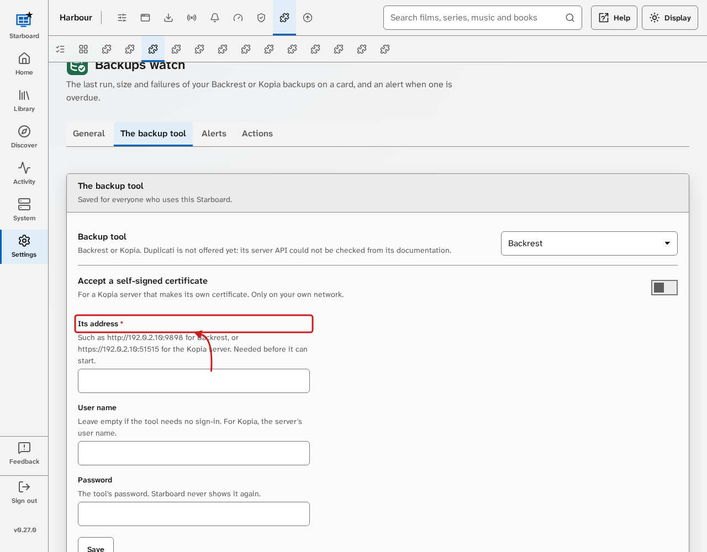
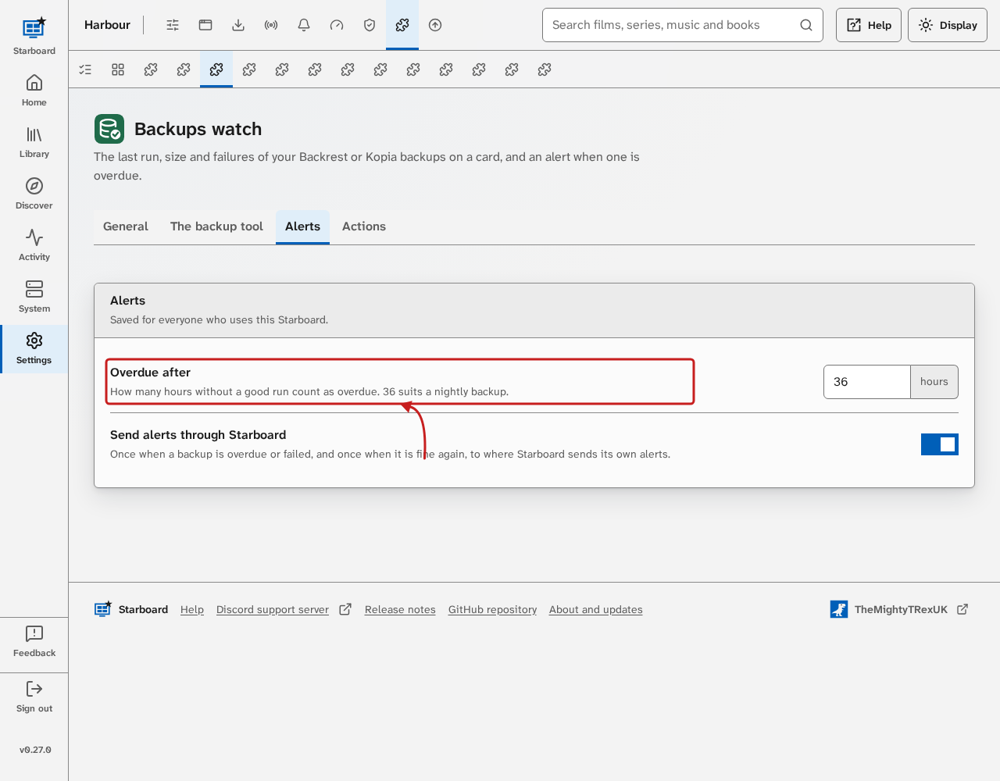

# Backups watch: Settings

Backups watch's settings are on its own tab: go to **Settings**, then **Plug-ins**, then **Backups watch**. Starboard draws them and keeps them; secrets are never shown again once saved.

## The backup tool

| Setting | What it does | Default |
|---|---|---|
| **Backup tool** | Backrest or Kopia. Duplicati is not offered yet: its server API could not be checked from its documentation. One of: Backrest, Kopia. | Backrest |
| **Its address** | Where the tool answers, such as http://192.0.2.10:9898 for Backrest, or https://192.0.2.10:51515 for the Kopia server. A web address. | Empty |
| **User name** | Leave empty if the tool needs no sign-in. For Kopia, the server's user name. Words. | Empty |
| **Password** | The tool's password. Kept secret by Starboard: it is never shown again. | Empty |
| **Accept a self-signed certificate** | For a Kopia server that makes its own certificate. Only on your own network. Activated or deactivated. | Deactivated |

## Alerts

| Setting | What it does | Default |
|---|---|---|
| **Overdue after** | How many hours without a good run count as overdue, from 1 to 1440. 36 suits a nightly backup. | 36 hours |
| **Send alerts through Starboard** | Once when a backup is overdue or its last run failed, and once when it is fine again, to where Starboard sends its own alerts. Activated or deactivated. | Activated |

## Buttons

- **Check now** asks the tool straight away, instead of waiting for the hourly check. It says how many backups it read and how many need attention.

## Good to know

- It checks once an hour. A backup is overdue when its last good run is older than **Overdue after**, or when it has never had one.
- For Backrest, each plan is one backup. For Kopia, each source (a user, a computer and a folder) is one backup.
- It keeps the last 30 runs it has kept of each backup, for the size card. A run that happened between two checks is not counted.
- Alerts need Starboard to take them from plug-ins, and that is on when Starboard's alerts are on in **Settings**, then **Alerts**.

## Find out more

- [Dashboard card](dashboard-card.md)
- [Problems](problems.md)
