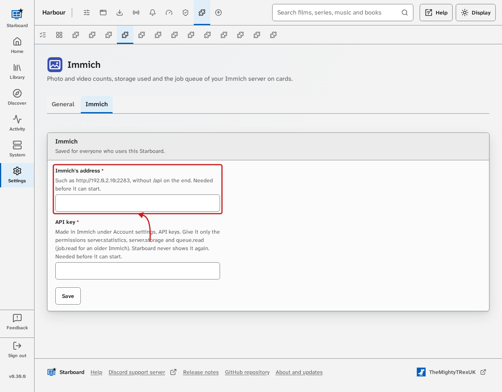
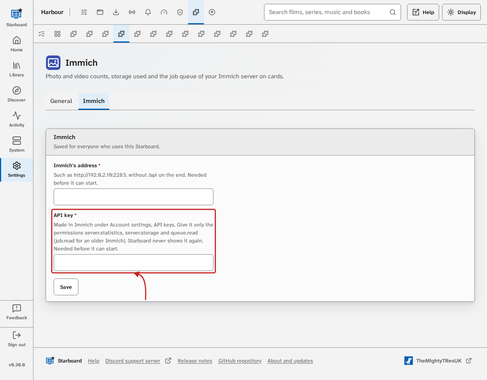

# Immich: Settings

Immich's settings are on its own tab: go to **Settings**, then **Plug-ins**, then **Immich**. Starboard draws them and keeps them; secrets are never shown again once saved.

## Immich

| Setting | What it does | Default |
|---|---|---|
| **Immich's address** | Such as http://192.0.2.10:2283, without /api on the end. A web address. Required. | Empty |
| **API key** | Made in Immich under Account settings, API keys. Give it only the permissions server.statistics, server.storage and queue.read (job.read for an older Immich). Kept secret by Starboard: it is never shown again. Required. | Empty |

## Good to know

- Make a key for Starboard alone, so you can remove it in Immich if you stop using the plug-in. Read only permissions are enough: it never changes anything.
- Nothing is asked until a card is shown. Each answer is kept for a minute, so a dashboard with all three cards makes three small requests a minute at most.
- Where Starboard and Immich run on the same computer, use the computer's own address on your network, not `localhost`: Immich's plug-in runs in its own container.

## Find out more

- [Dashboard card](dashboard-card.md)
- [Problems](problems.md)
