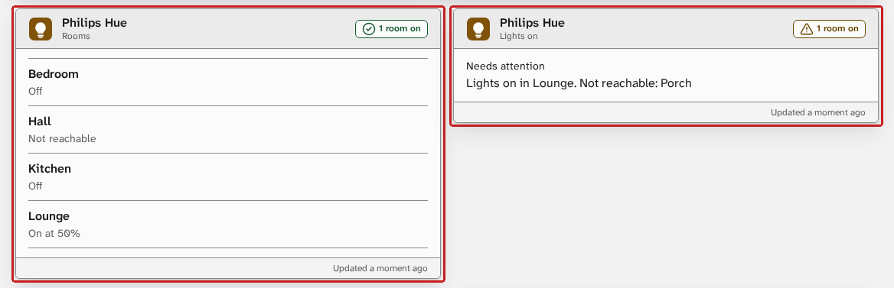
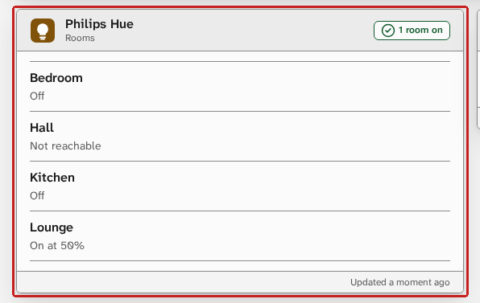
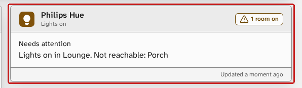
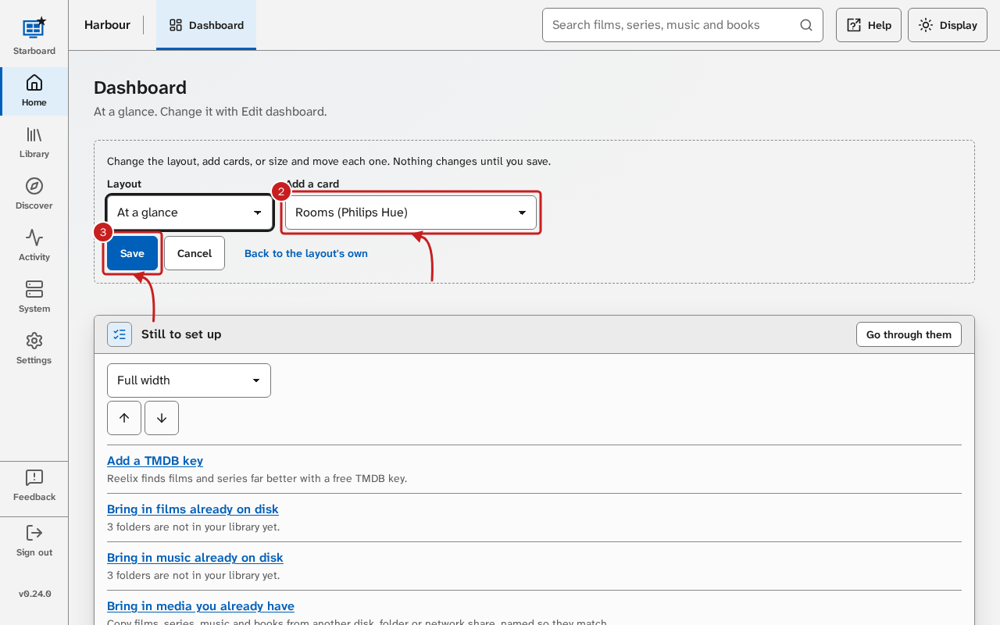

# Philips Hue: Dashboard card

Philips Hue adds 2 cards you can put on your dashboard: **Rooms** and **Lights on**. Each starts with a band: its logo and name and a status in words. A footer says when it last changed. Starboard asks each card once a minute while the dashboard is open, never while the browser tab is hidden. To answer, the plug-in reads the bridge on your home network.

## Rooms

A list of your rooms, up to 10, each with its lights in words. Each room says **Off**, **On at** a brightness, or how many of its lights are on when only some are. It says **Not reachable** when the bridge can reach none of them. The band says how many rooms have lights on, or **All off**.

- **Example:** Kitchen: On at 80%, 2 of 3 lights

## Lights on

One line: the rooms with lights on, or "Every light is off". It also names up to 4 lights the bridge cannot reach.

- **Example:** Lights on in Kitchen and Lounge

## What the status says

| Status | Means |
|---|---|
| **OK** | Shown as how many rooms are on, such as **2 rooms on**, or as **All off** on Lights on: the bridge answered. On Lights on, every light can be reached too. |
| **Idle** | Shown as **All off** on Rooms: every light is off. Also when the bridge has no rooms yet: make them in the Hue app. |
| **Warning** | On Lights on: at least one light cannot be reached, and the card names it. Its band still says how many rooms are on. |
| **Needs setting up** | No bridge is paired yet. Pair one on **Bridge**: read [Install](install.md). |
| **Problem** | Shown as **Not answering**: the bridge did not answer, and the card says why. Read [Problems](problems.md). |

## Every light off or on

Plug-in cards cannot hold buttons, so the quick switch is in **Actions** on the plug-in's tab: **Turn every light off** and **Turn every light on**. Each uses the bridge's own group for every light in the home, as the Hue app does.

## Add it to your dashboard

1. Select **Edit dashboard**.
2. In **Add a card**, choose **Rooms** or **Lights on**, each with (Philips Hue) after it.
3. Select **Save**.

## Find out more

- [Use and change the dashboard, in Starboard's help](https://themightytrex.github.io/starboard/help/topics/use-the-dashboard.html)
- [Settings](settings.md)
- [Problems](problems.md)
