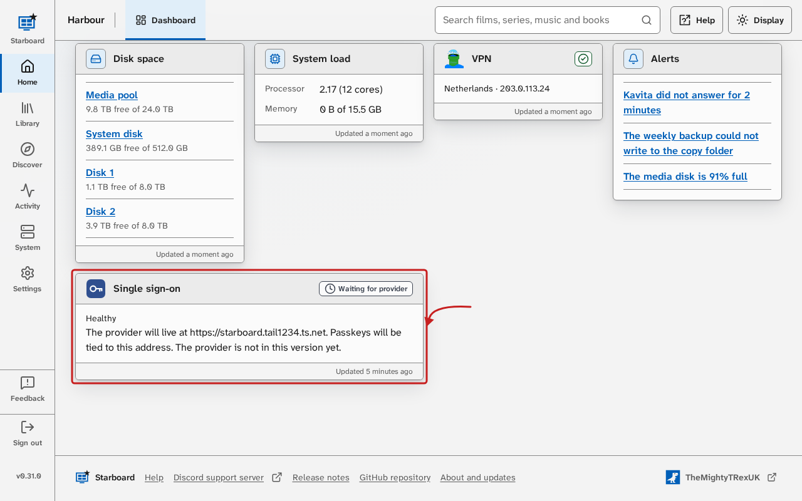
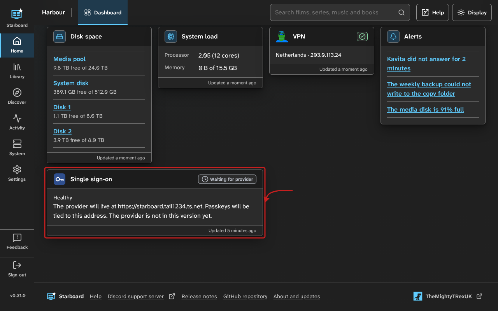
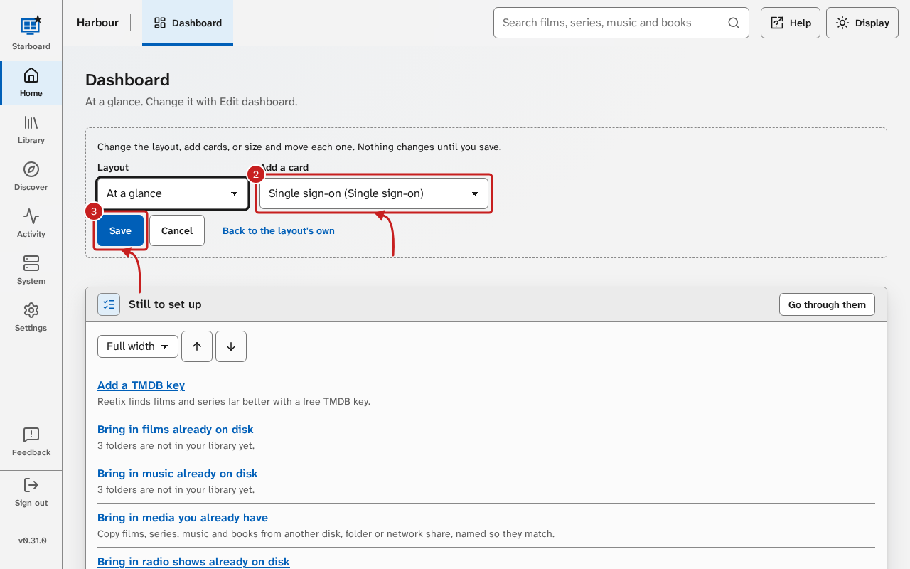

# Single sign-on: Dashboard card

Single sign-on adds 1 card you can put on your dashboard. It starts with a band: its logo and name and a status in words. A footer says when it last changed.

## Single sign-on

Shows whether single sign-on is off, needs a name, has a name that changed, or is waiting for the provider.

- **How often it updates:** every 5 minutes while the dashboard is open. Nothing is asked while the browser tab is hidden.
- **Example:** The provider will live at https://starboard.tail1234.ts.net. Passkeys will be tied to this address. The provider is not in this version yet.

## What the status says

| Status | Means |
|---|---|
| **Off** | Single sign-on is off. Nothing runs for it and nothing is asked of Tailscale. |
| **Needs a name** | It is on, but the Tailscale name is empty or is not a full Tailscale name. The card says what is wrong. |
| **Waiting for provider** | The name is good and kept. The provider is not in this version yet. |
| **Name changed** | The name in the settings differs from the one kept. Passkeys made at one address do not work at another. |

## Add it to your dashboard

1. Select **Edit dashboard**.
2. In **Add a card**, choose **Single sign-on (Single sign-on)**.
3. Select **Save**.

The plug-in must be added and active first. Read [Install](install.md).

## Find out more

- [Use and change the dashboard, in Starboard's help](https://themightytrex.github.io/starboard/help/topics/use-the-dashboard.html)
- [Settings](settings.md)
- [Problems](problems.md)
