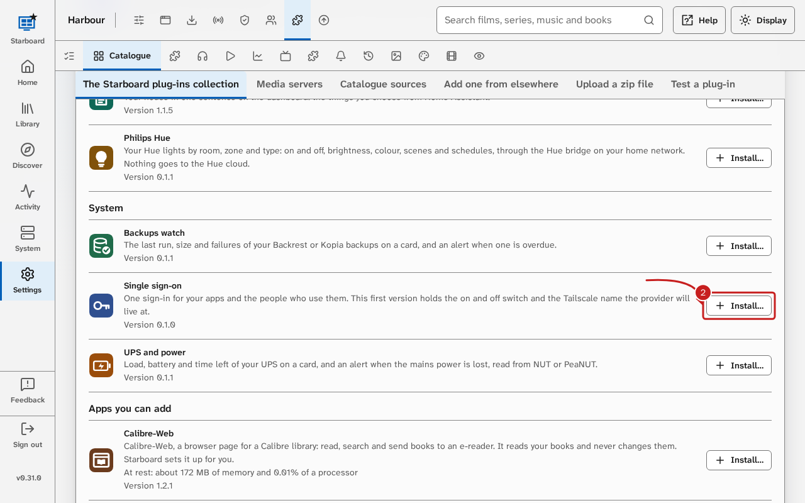
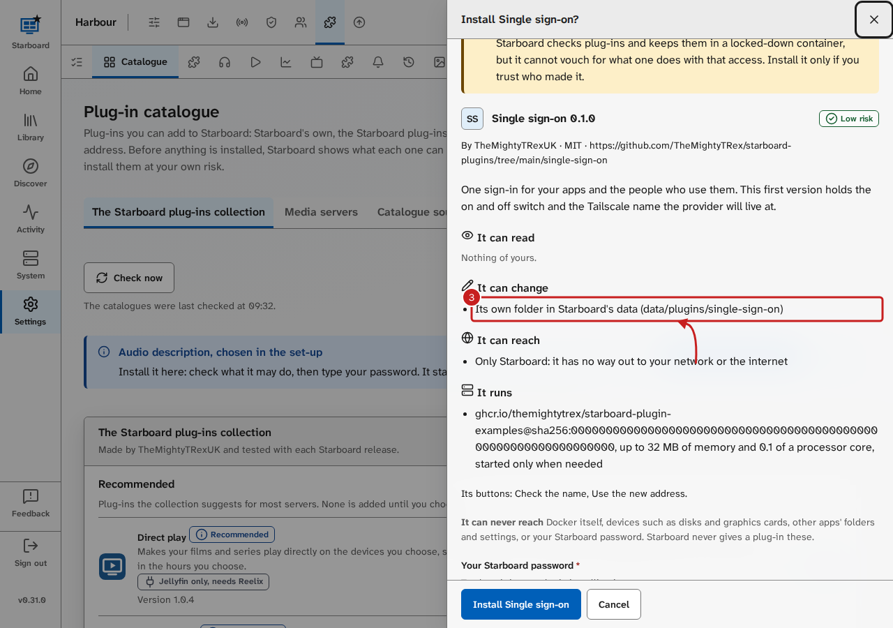
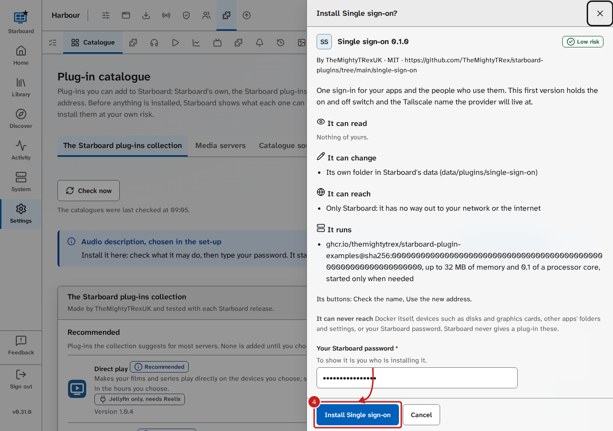

# Single sign-on: Install

Add Single sign-on from Starboard's **Catalogue**, where it is listed under **System**. Starboard shows what it may do and tests it before anything is added. At the end, Single sign-on is added and off, so nothing changes until you choose.

This is the first version. It holds an on and off switch and the Tailscale name the sign-in provider will live at. The provider is not in it yet.

## Before you begin

- Starboard with plug-in API 1.17 or later (Starboard 0.26.0 or later).
- The Tailscale name of your server, such as `starboard.tail1234.ts.net`. Read [Settings](settings.md) for where to find it and why you set it only once.
- Your Starboard password. Adding and removing a plug-in ask for it.

## What it may do

Starboard lists these before you add it.

| Permission | Risk |
|---|---|
| None | Nothing beyond its own folder |

What it runs:

- **main:** it has no network access beyond Starboard's own. It can use its own folder in Starboard's data (`data/plugins/single-sign-on`). It rests after 5 minutes with nothing to do, and Starboard wakes it when its card asks.

Like every plug-in, it runs read only, as a user that is not root, with no extra rights. This version makes no network call, and it never asks Tailscale.

## Memory and processor

- **main:** 32 MB of memory and 0.1 of a processor core at most, and only while its card is being asked. At rest it uses nothing: its container is stopped.

## Add it

1. Go to **Settings**, then **Plug-ins**, then **Catalogue**.
2. Under **System**, find **Single sign-on** and select **Install…**.



3. A slide-out opens with what it can read, change and reach. Read it all.



4. Enter your Starboard password and select **Install Single sign-on**. To stop, select **Cancel**: nothing is installed.



5. Its own tab opens under **Settings**, then **Plug-ins**. Read [Settings](settings.md), choose the Tailscale name, then select **Activate**.

### Add it by its address

On the **Catalogue** page, under **Add one from elsewhere**, paste this into **The plug-in's manifest address**. Then select **What it does** and carry on from step 3:

```text
https://raw.githubusercontent.com/TheMightyTRex/starboard-plugins/main/single-sign-on/starboard-plugin.json
```

Or run its installer, `install.py` in its folder, on any computer with Python, and give your Starboard's address.

## Remove it

1. Go to **Settings**, then **Plug-ins**, then **Single sign-on**.
2. Under **Remove**, select **Remove Single sign-on**.
3. Choose where its folder goes: **Keep it with Starboard's data** (in `data/plugins/.removed`) or **Move it to the holding folder**. The holding folder is listed in **System**, **Clean up**, where you can put it back or delete it for good.
4. Enter your Starboard password and select **Remove**.

Its container stops and goes. Your apps and the people in **Settings**, **People** are not touched.

## Find out more

- [What Single sign-on does](../../../single-sign-on/README.md)
- [Settings](settings.md)
- [Problems](problems.md)
- [Add a plug-in, in Starboard's help](https://themightytrex.github.io/starboard/help/topics/add-a-plugin.html)
- [What a plug-in can change, in Starboard's help](https://themightytrex.github.io/starboard/help/basics/what-plugins-can-change.html)
