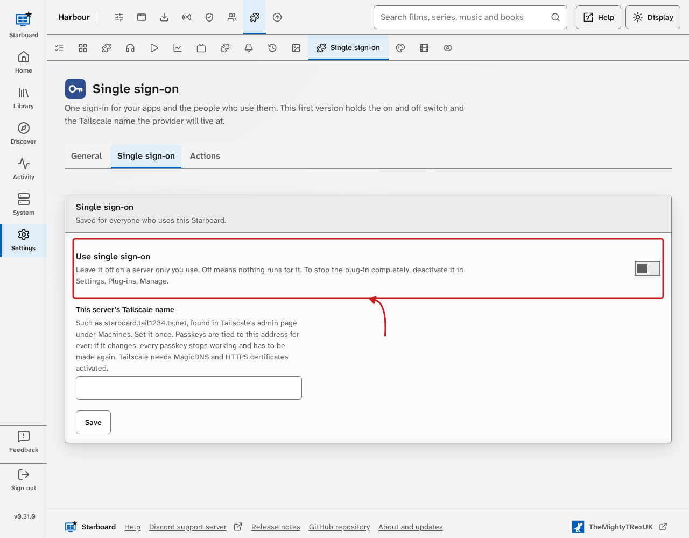
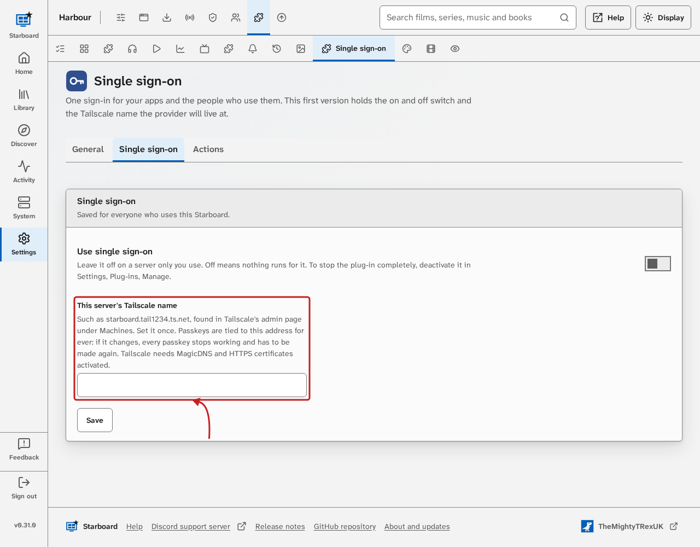

# Single sign-on: Settings

Its settings are on its own tab: go to **Settings**, then **Plug-ins**, then **Single sign-on**. Starboard draws them and keeps them.

## Single sign-on

| Setting | What it does | Default |
|---|---|---|
| **Use single sign-on** | Leave it off on a server only you use. Off means nothing runs for it. To stop the plug-in completely, deactivate it in Settings, Plug-ins, Manage. | Off |
| **This server's Tailscale name** | Such as starboard.tail1234.ts.net, found in Tailscale's admin page under Machines. Set it once. Passkeys are tied to this address for ever. | Empty |

## Passkeys are tied to the address for ever

A passkey is made for one web address. A passkey made at `starboard.tail1234.ts.net` does not work at any other address, and Starboard cannot move it. If the address changes, every person makes their passkeys again.

So choose the name once, and keep it:

- Use the full name that ends in `.ts.net`, such as `starboard.tail1234.ts.net`. You can write it with or without `https://`. A `100.` address, a port or a path is refused, with the reason in words.
- Find the name in Tailscale's admin page under **Machines**, or run `tailscale status` on the server.
- Tailscale needs **MagicDNS** and **HTTPS certificates** activated in its admin page, under **DNS**, so the provider can have a secure address.
- The plug-in keeps the first valid name in its own folder. If the setting later differs, the card says **Name changed** and keeps the first name. Passkeys made at one address do not work at another.
- **Use the new address** (under **Actions**) asks first, then keeps the name now in the settings. Use it only to start again. No provider exists in this version, so no passkey is lost yet.

## Good to know

- **Check the name** (under **Actions**) says where the name stands. It does not ask Tailscale or any other computer.
- Switching single sign-on off keeps the name. Switching it on again later uses the same one.
- Starboard stays the one page you use and the one list of people: add the people in **Settings**, **People**. Read [Add the people who use your apps](https://themightytrex.github.io/starboard/help/topics/add-the-people-who-use-your-apps.html).

## Find out more

- [Dashboard card](dashboard-card.md)
- [Problems](problems.md)
