# Create your own TV channel: Settings

Create your own TV channel's settings are on its tab in **Settings**, then **Plug-ins**. Choices save as soon as you make them. Its pages, **Channels**, **Guide**, **Schedule grid**, **Idents, clips and music**, **Broadcast pack** and **Animation**, open from the same tab. A change saves in place: the page stays where it was, with the channel open, and says what was saved beside what you changed.

Each section here says what each setting does, its choices and the one it starts with, and shows an example of the result. The examples are drawn by the plug-in's own code over a made-up picture, with the example pack, Example TV.

## Settings at a glance

| Section | Where it is | What it sets |
|---|---|---|
| [Channels](#channels) | **Channels** | Add, name, number and order your channels |
| [What each channel shows](#what-each-channel-shows) | **Channels**, the **What it shows** card | The series, films, collections, playlists, genres and decades on each channel |
| [Schedule grid](#schedule-grid) | **Schedule grid** | A week for each channel, in 15 minute steps |
| [Breaks and idents](#breaks-and-idents) | **Channels**, the **Breaks** and **Holding slide and promos** cards, and **Idents, clips and music** | What plays between programmes |
| [On-screen logo](#on-screen-logo) | The station's settings, and each channel's **On-screen logo and branding** card | The logo in the corner of the picture, the clock and the label |
| [Straps and cards](#straps-and-cards) | The station's settings | The programme's name, Up next, and the Coming up next and Later cards |
| [Promos](#promos) | The station's settings | Short trailers for programmes coming up |
| [Broadcast pack](#broadcast-pack) | **Broadcast pack** | Your own branding for every channel |
| [Animation](#animation) | **Animation**, and each channel's **Animation** card | How things drawn over the picture come on and go off |
| [Streaming](#streaming) | The station's settings | Picture size and how many channels play at once |
| [Station](#station) | The station's settings | The station's name, numbers and the guide |

The station's settings are for every channel. A channel's own choice, on its page in **Channels**, comes first; **Station default** on a channel uses the station's choice, which the option names.

## Channels

**Channels** lists your channels, each on a card with its number, its name, whether it is on air and what is on now. Select a channel to open it. An opened channel has a card for each part of it, each saying what it is for: **Name and number**, **What it shows**, **Breaks**, **On-screen logo and branding**, **Animation**, **Holding slide and promos**, **Today and tomorrow**, and **Played on this channel**.

### Add a channel

1. In **Add a channel**, enter its name, such as Comedy, and select **Add a channel**. It is on air from the start.
2. Open it, and choose what it shows, as [What each channel shows](#what-each-channel-shows) says.
3. In Jellyfin's Live TV, your channels are first in the list.

### Name and number

| Setting | What it does | Choices, and the one it starts with |
|---|---|---|
| **On air** | Puts the channel in Jellyfin's Live TV. **Up** and **Down** move it in the list, which sets its number. **Remove** takes it off; its settings are kept in the plug-in's folder | Activated |
| **Name** | Select **Rename**. Shown in Jellyfin, in the guide, on the cards and promos, and as the on-screen logo when that is **The channel's name** | Up to 40 characters |
| **Number** | Select **Change number**. Leave it empty to number it by its place in the list | Empty, so numbered from **First channel number** |
| **Colour** | Used on its Coming up next cards, its made logo and its plain promos | **Blue**, **Green**, **Red**, **Purple**, **Orange**, **Teal**, **Pink**, **Grey**, **Gold** or **Navy**. Each new channel has the next colour in turn |

A change to what a channel shows, its order or its times starts after the programme on air ends, so nobody watching meets a jump.

## What each channel shows

On the channel's **What it shows** card:

1. Select **Choose from your library**. A slide-out opens.
2. Select **Series**, **Films**, **Collections**, **Playlists**, **Genres** or **Decades**: each lists every one Jellyfin has, 100 at a time, with **Show more** for the rest. Enter words in **Search by name** to narrow the list.
3. Tick each one you want. Ticks are kept as you change kind or search, and the ones on the channel already show as added.
4. Select **Add the ticked ones**. The slide-out closes, focus goes back to **Choose from your library**, and the card says what was added.

With Starboard before 0.24.0 there is no slide-out: the card has **Add a series**, **Add a film** and the rest, each taking a name.

Its line-up is read from Jellyfin straight away. The programmes for today and tomorrow are listed at the end of the channel's page, under **Today and tomorrow**.

| Setting | What it does | Choices, and the one it starts with | Example result |
|---|---|---|---|
| Each series, film, collection, playlist, genre or decade | **Up** and **Down** set the order; **Remove** takes it off | As many as you like | Two series and a collection of films |
| **Order** | **In order** plays each series in aired order, taking turns. **Shuffled** plays them in a new order each time round | **In order** or **Shuffled**. **In order** | In order: series A episode 1, series B episode 1, series A episode 2 |
| **Episodes of a series in a row** | How many episodes of one series play before the next has its turn | 1 to 6. **1** | 2: series A episodes 1 and 2, then series B episodes 1 and 2 |
| **Create initial schedule** | Makes a week from this channel's own series and films, watched or not: series one after another on weekdays, each the next episode every day, and films at the weekend. Check **Hours to fill** and confirm. The week waits in the schedule grid as a suggestion to change, then **Save the suggestion**; a grid you saved before stays as it is until then. **Open the schedule grid** on the row goes there | **Hours to fill**: weekdays 18:00 to 23:00 and weekends 12:00 to 23:00, on the quarter hour | Monday to Friday evenings of series, and films on Saturday and Sunday afternoons |

New episodes join the line-up at the end of the programme on air. **Read the channels from Jellyfin again**, in [Actions](#actions), reads them now; it also runs each night at 04:40.

### What a channel has played

| Setting | What it does | Choices, and the one it starts with |
|---|---|---|
| **Count what this channel has played as watched** | For **From the next episode not watched**, an episode this channel played to someone watching, 70% or more of it, counts as watched, as well as the ones Jellyfin says were played | **Yes** |
| The last 5 programmes | When each was on, and how many of its minutes were played to someone watching: **Watched** at 70% or more, else **Part watched** | Listed on the **Played on this channel** card |
| **The record of what it has played** | **Remove**, in its More menu, forgets everything this channel has played, after you confirm. Jellyfin is not changed | Kept until you remove it |

A channel streams only while someone is watching it in Jellyfin's Live TV, so what it plays is what was watched. For each episode and film it keeps when it was on and how much of it was played, in its own small file in the plug-in's folder, the newest 5,000 programmes. It never tells Jellyfin, so Jellyfin's watched marks, and **Continue watching**, stay as they were.

## Guide

**Guide** starts by saying when Jellyfin last read the guide, and how many programmes on how many channels it had, so you can tell Jellyfin has it. It then has a table for each channel: what is on in the next 24 hours, with the time, the programme, the episode, New or Repeat, and what it is about. Jellyfin's own guide has as many days as **Days in Jellyfin's guide** says. An episode or film first shown in the last 30 days is New; anything older is a Repeat.

## Schedule grid

**Schedule grid** lists your channels, each with an **Open the schedule grid** link that opens its grid in a new tab, on the plug-in's own page, in a desktop browser. From Starboard 0.24.0 the link uses the address you opened Starboard with.

The grid is a week, Monday to Sunday, in 15 minute steps. Films and series placed on it play at those times every week; the time between them keeps the channel's automatic line-up, whole programmes only, and the rest is a break. A channel with nothing on its grid is as it was. The guide in Jellyfin follows the grid.

| On the grid | What it does | Example result |
|---|---|---|
| **Channel**, **Show** and **Day** | Which channel, and the whole week or one day | Comedy, the whole week |
| **Add a programme**, or an empty time | Search Jellyfin, choose a film or series, its day and time and, for a series, where it starts | A series at 21:00 on Monday, every Monday |
| Drag a programme to an empty time | Moves it. Everything a drag does can also be done without one: select a programme for **Move 15 minutes earlier**, **Move 15 minutes later**, **Move to** a day and time, or **Pick it up, then choose a time** and select an empty time | Monday 21:00 moved to 21:15 |
| **Stripe across the week** | On a series: the same time on the weekdays you choose, 1 to 4 episodes each day, Saturday and Sunday too if you choose. Each slot plays the next episode in order, and the next week carries on | 2 episodes at 19:00, Monday to Friday: episodes 1 and 2 on Monday, 3 and 4 on Tuesday |
| **Where the series starts** | The first episode, the next episode not watched, or a series and episode you choose, from this week | Series 2, episode 4 |
| **Copy a day** | Copies one day to the days you choose, in place of what was on them | Monday copied to Tuesday to Friday |
| **Suggest a schedule** | Asks what to make the week from, then proposes it, the most watched first. **This channel's line-up**: every series and film the channel shows, in its order, watched or not. **Watch history**: the channel's own series and films people have watched. **General watch history**: everything anyone has watched, whatever the channel shows. **All TV**: series from the whole library, every day. **All films**: films from the whole library. **TV and Films**: series on weekdays and films at the weekend, from the whole library. Then **Hours to fill**: **Fill weekdays** and **Fill Saturday and Sunday**, each **From** and **To**, in half hours; a programme that would run past the end is left out. The choices and hours are remembered for each channel. Nothing is saved until you select **Save the suggestion**; **Discard the suggestion** keeps the grid as it was | TV and Films, weekdays 18:00 to 23:00: five evenings of series and a weekend of films |
| **Undo** | Takes back the last change | The last move undone |

A programme takes the time of its longest episode, rounded up to 15 minutes, so programmes never run into each other. A change that would overlap another programme is refused, and the message names it. In the grid, the arrow keys move between times and days, Page Up and Page Down by an hour, and Enter opens a programme's actions or adds one at an empty time.

## Breaks and idents

A break fills the time between programmes. It opens with a bumper, then promos, trailers and clips, then one extra video, then the holding slide or Coming up next cards, and ends with one ident immediately before the next programme. A transition from the broadcast pack plays at each cut between a programme and a break.

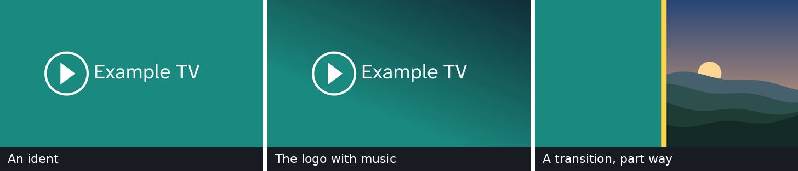

### Each channel's breaks

On the channel's **Breaks** card:

| Setting | What it does | Choices, and the one it starts with | Example result |
|---|---|---|---|
| **Programmes start** | When each programme starts, with a break filling the time to it | **Back to back**, **On the quarter hour**, **On the half hour** or **On the hour**. **On the half hour** | On the half hour: a programme ending at 20:52 has an 8 minute break, then the next starts at 21:00 |
| **Break between programmes** | Added after each programme. With programmes on the half hour, the break also fills the rest of the slot | **No break**, **1 minute**, **2 minutes**, **3 minutes** or **5 minutes**. **No break** | 3 minutes, back to back: a programme ending at 20:40 is followed by a break, and the next starts at 20:43 |
| **Breaks inside programmes** | Where a programme made for commercial television fades to black with a moment of silence for its adverts, a short break plays there: a bumper, promos, trailers or clips, one extra video, the holding slide with Back soon, and a bumper. There is no ident. The places are found in quiet hours, from Jellyfin's Commercial markers or from the sound and picture, for programmes on in the next 48 hours, and each programme is checked once. Up to 1 break in a programme under 40 minutes, 2 under 75 minutes and 3 in a longer one. A programme with no clear fade to black, such as most films, has none. Their time comes from the break after the programme, so the schedule never moves | **Off**, **Up to 1 minute each**, **Up to 2 minutes each** or **Up to 3 minutes each**. **Off** | Up to 2 minutes each: a 45 minute episode with two fades to black has two short breaks |
| **Idents** | Whose idents play before each programme | **None**, **This channel's**, **The station's** or **This channel's and the station's**. **This channel's and the station's** | One ident, then the programme |
| **Idents play** | The order idents play in. A broadcast pack's idents always play in a random order | **In order** or **In a random order**. **In order** | In order: ident 1, then 2, then 3 |
| **Trailers** | Jellyfin's own trailers of the films on this channel | **None** or **Trailers of its films, from Jellyfin**. **None** | A film's trailer in the break |
| **Your clips** | Whose clips play | **None**, **This channel's**, **The station's** or **This channel's and the station's**. **This channel's and the station's** | A clip you added |
| **Promos and clips in each break** | Each promo, trailer and clip plays once at most in a break, in a random order, after the bumper. The holding slide fills the rest | **Up to 2**, **Up to 3**, **Up to 4** or **Up to 6**. **Up to 3** | Up to 3: a promo, a trailer and a clip |
| **Extra videos** | One plays at random after the promos in each break, when it fits | **None**, **This channel's**, **The station's** or **This channel's and the station's**. **This channel's and the station's** | A 2 minute short film |
| **Add an ident**, **Add a clip** | Choose a video of up to 60 MB, or enter the name of a Jellyfin collection or folder of them. A clip can be up to 10 minutes | Videos you add | A 10 second ident |
| **Add an extra video** | Select **Upload an extra video** and choose a video of up to 10 minutes and 90 MB. Add as many as you like. **Remove** in its More menu takes one off | Videos you add | A 5 minute music video |

### Holding slide

The holding slide loops at the end of each break, after the promos, until the next programme starts, so the channel never shows black. With none, breaks end on Coming up next cards.

On the channel's **Holding slide and promos** card:

| Setting | What it does | Choices, and the one it starts with |
|---|---|---|
| **Holding slide** | Which slide this channel uses | **The station's holding slide**, **Its own holding slide** or **No holding slide**. **The station's holding slide** |
| **Its own holding slide** | Select **Upload a holding slide** and choose a PNG or JPEG picture, or a video of up to 120 seconds and 90 MB, which loops. It is checked with FFmpeg first | A picture or video you add |
| **Words on the slide** | What is written low in the middle of the slide, on a dark plate | **A countdown to the next programme**, **Back soon** or **No words**. **Station default** uses the choice in **Idents, clips and music** |
| **Preview the holding slide** | Opens a frame of the slide with its words, in a new tab | None |

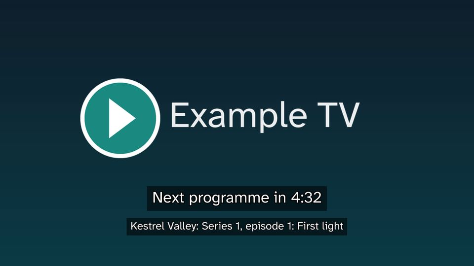

*A countdown to the next programme: it reaches 0:00 as the programme starts, with the programme's name under it.*

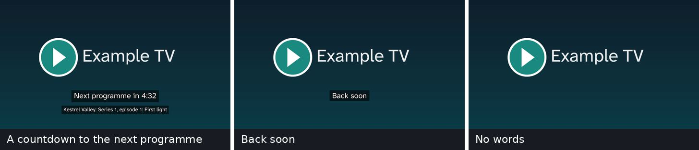

*Each choice for **Words on the slide**.*

### The station's idents, clips and music

**Idents, clips and music** holds the station's own idents and clips, for every channel that chooses **The station's** or **This channel's and the station's**. Add a video of up to 60 MB, or the name of a Jellyfin collection or folder of them.

| Setting | What it does | Choices, and the one it starts with |
|---|---|---|
| **The station's holding slide** | Select **Upload a holding slide** and choose a PNG or JPEG picture, or a video of up to 120 seconds and 90 MB. Every channel without its own slide uses it | None until you add one |
| **Words on the slide** | The words for every channel left at **Station default** | **A countdown to the next programme**, **Back soon** or **No words**. **A countdown to the next programme** |
| **Music the promos use** | Which music promos choose from. A channel's own music comes first. With no music of the kind chosen, the other is used | **Your music and the pack's**, **Only your music** or **Only the pack's music**. **Your music and the pack's** |
| **Add an extra video for the breaks** | Select **Upload an extra video** and choose a video of up to 10 minutes and 90 MB, as many as you like | Videos you add |
| **Add music for promos** | Select **Upload music** and choose an MP3, M4A, OGG or FLAC file of 5 seconds to 10 minutes and up to 60 MB, up to 20 tracks. Each is checked with FFmpeg and played at the same loudness as the rest. **Remove** in its More menu takes it off | Music you add |
| **Add a background loop for promos** | Select **Upload a background loop** and choose a video of 2 to 60 seconds that loops, or a PNG or JPEG picture, 1920 by 1080 and up to 90 MB, up to 20 loops. Every channel's promos choose from these, its own and its pack's promo background, one at random for each promo. Leave the clip area and the places for the words clear. **Remove** in its More menu takes it off | Loops you add |

With music or a background loop here, a channel whose pack has no promo, or that has no pack, gets plain promos: the programme's clips and words on a loop, or on the channel's colour.

## On-screen logo

The logo in a corner of the picture, as on broadcast television (also called the DOG, or bug). The station's choices are for every channel. Each channel can choose its own on its **On-screen logo and branding** card, where every setting starts at **Station default**.

*Every setting as it starts: the channel's logo, **Top right**, medium, inside the safe area, at 80% with the backing plate.*

### On-screen logo setting

What the logo is. **The channel's logo** is the logo added on the channel's page, else the broadcast pack's `logo/dog.png`; with neither, the channel's name is drawn in its place.

Choices: **The channel's logo** (the one it starts with), **The channel's name**, **The station's name** or **No on-screen logo**.

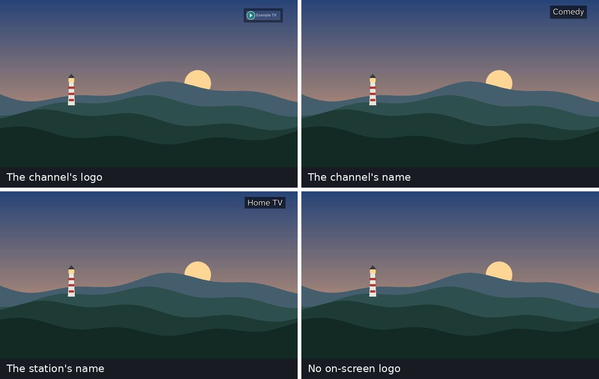

### Corner

Which corner of the picture it sits in. The clock and the label sit beside it, away from the edge, and the straps go in the other bottom corner.

Choices: **Top right** (the one it starts with), **Top left**, **Bottom right** or **Bottom left**.

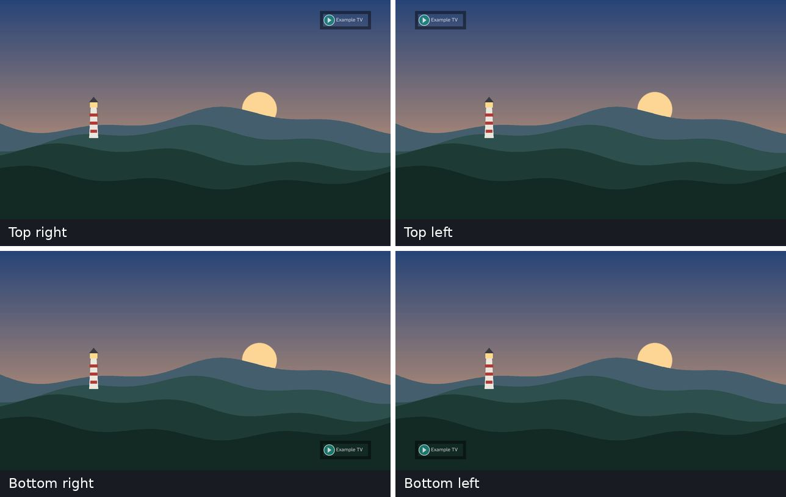

### Size

How tall it is, as a share of the picture's height.

Choices: **Small**, 6% (65 pixels at 1080); **Medium**, 8.5% (92 pixels), the one it starts with; or **Large**, 12% (130 pixels).

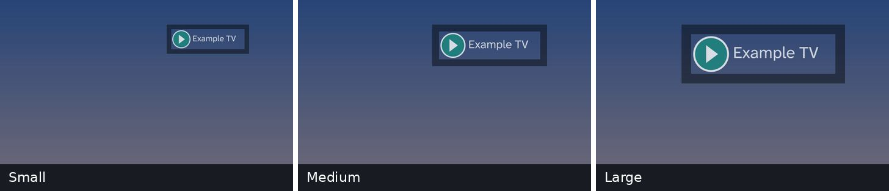

### Distance from the edge

How far it sits from the top or bottom, and from the side. Some televisions cut the edges of the picture, so **Inside the safe area** keeps it in the picture on every television.

Choices: **Close**, 2.5% in; **Inside the safe area**, 5% in, the one it starts with; or **Further in**, 7.5% in.

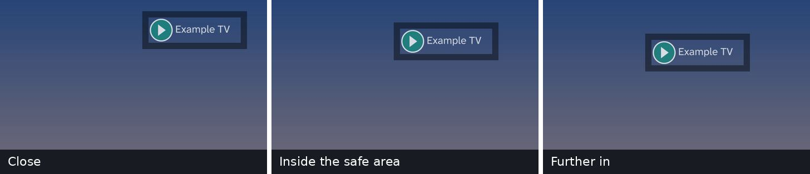

### Opacity

How solid it is: 100% is solid, and less lets the picture show through.

Choices: 30% to 100%. It starts at 80%.

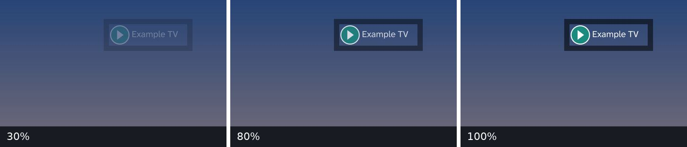

### When it shows

Which parts of the channel it shows on. Clips are idents, trailers and your own clips.

Choices: **Always** (the one it starts with); **Only during programmes**; or **Programmes and cards, not clips**, which also shows it on the holding slide. With the last two, it comes on as a programme starts and goes off as it ends, as [Animation](#animation) says.

Example result: with **Only during programmes**, the logo is on the programme but not on the ident before it or the trailer after it.

### Fades in after the opening

Keeps a programme's opening titles clear: the logo appears after that time.

Choices: **No, at once** (the one it starts with), **After 30 seconds**, **After 1 minute** or **After 2 minutes**.

Example result: with **After 1 minute**, the first minute of each programme has no logo, then it fades in and stays.

### Clock and Label

**Clock** writes the time beside the logo, from the server's clock. It starts deactivated.

**Label** writes New or Repeat, or Live, in words, for the first 2 minutes of each programme. New is an episode or film first shown in the last 30 days, as in the guide. Choices: **No label** (the one it starts with), **New or Repeat** or **Live**.

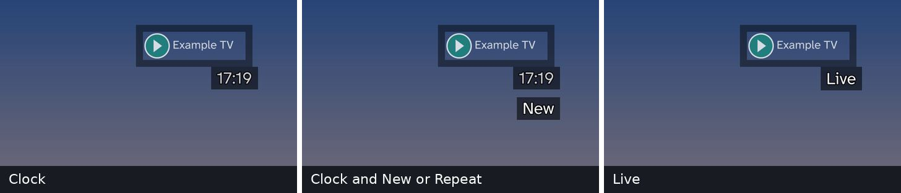

### Backing plate

A dark, partly transparent box behind the logo, the clock and the label, so they are clear on any picture, even a bright one. It starts activated.

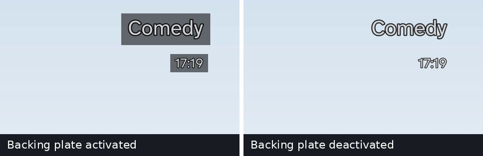

### Logo, Broadcast pack and the previews

On the channel's **On-screen logo and branding** card:

| Setting | What it does | Choices, and the one it starts with |
|---|---|---|
| **Logo** | Select **Add logo** and choose a PNG with a clear background, at least 256 pixels tall. It is used in place of the pack's logo. With neither, a logo with its number and name is made. The logo in use shows on the card as a small picture. **Remove the logo** takes it off | The pack's logo |
| **Broadcast pack** | Which pack this channel uses, as [Use a broadcast pack](../../use/use-a-broadcast-pack.md) says | **The station's pack**, **Its own pack** or **No pack**. **The station's pack** |
| **Its own pack** | Select **Upload its own pack** and choose a zip made from the template, then choose **Its own pack** in **Broadcast pack**. **Remove its pack** takes it off | None |
| **Preview a frame** | Opens a frame of what is on now, drawn with the settings, in a new tab | None |
| **Preview a Coming up next card** | Opens the next card, in a new tab | None |

## Straps and cards

The station's choices. A channel can choose its own on its **On-screen logo and branding** card.

### Programme name at the start

The programme's name, with its series and episode, in a strap low in the corner for 8 seconds as each programme starts. It starts activated.

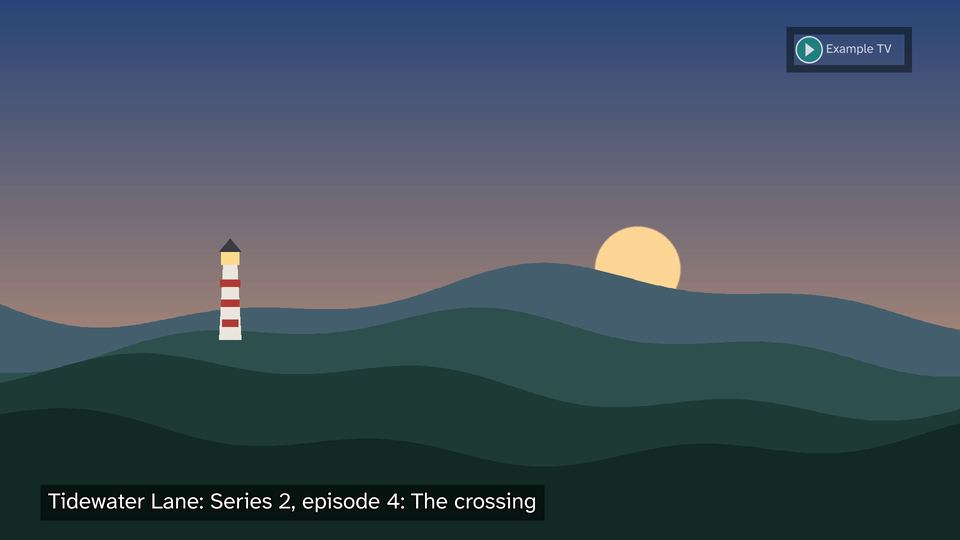

### Up next during the end credits

The next programme and its time, in a strap low in the corner, during the end credits of each programme. It starts activated.

**Up next shows for** sets how long, until the programme ends: 5 to 120 seconds. It starts at 30 seconds.

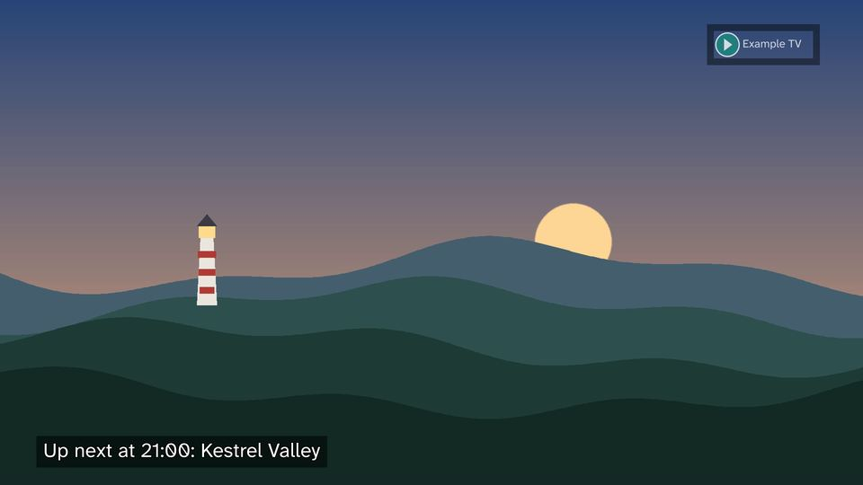

### Coming up next and Later cards

In the breaks: the programme's picture, its title, its series and episode, the date and time it is shown and a short synopsis. The card for the next programme says Coming up next; a card for one after that says Later on and the channel's name. Deactivated, a break with no clips shows the station's name. It starts activated.

With no broadcast pack, the card is drawn on the programme's own picture, darkened to a third of its brightness so the words are clear, with a bar in the channel's colour.

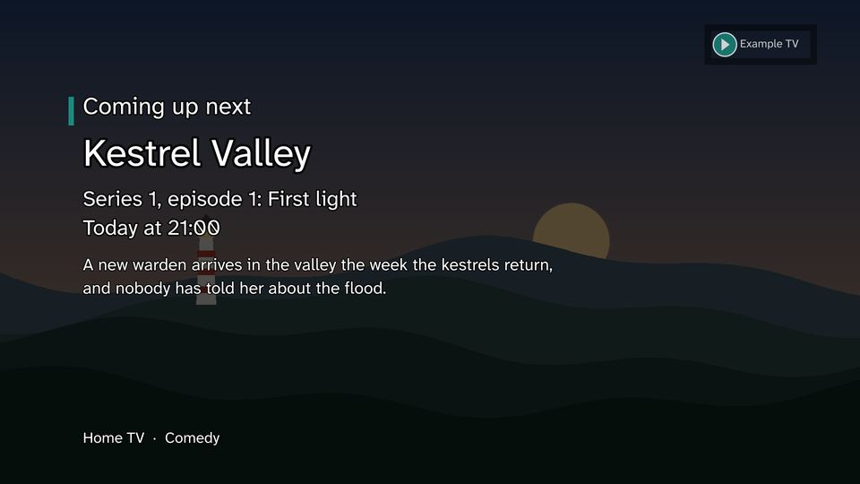

With a broadcast pack, the card is drawn on the pack's Coming up next background, with the programme's picture in its clip area and each field where `pack.json` places it.

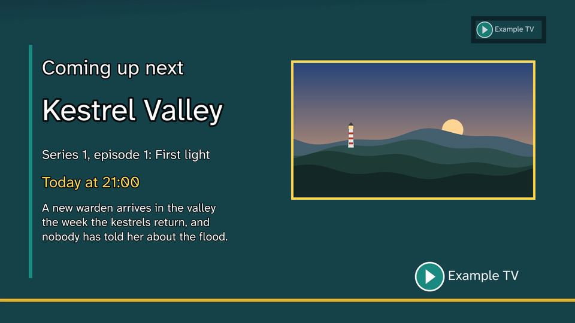

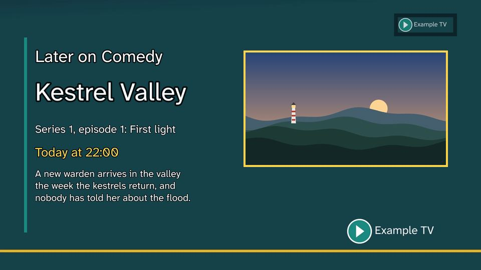

## Promos

Promos are short trailers for programmes coming up, made by the plug-in in quiet hours. They are made for channels whose broadcast pack has a promo background, and for any channel when there is music or a background loop for promos in **Idents, clips and music** or on the channel.

A promo has a few short clips of the programme in its clip area, with its sound, a music bed, and its title, the day and time and the channel. It gives the day and time, such as Sunday at 21:00, as it is made days before it plays.

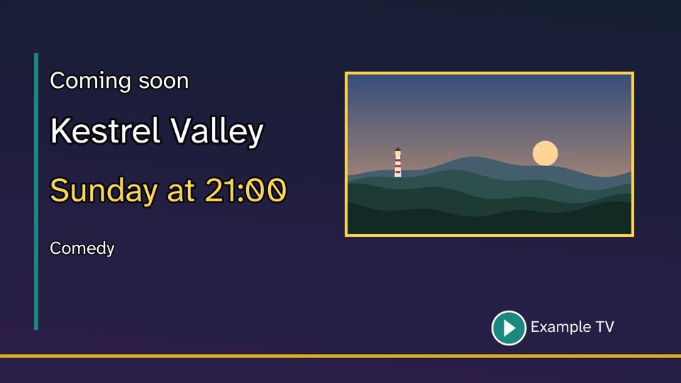

*A promo made with the example pack's promo background.*

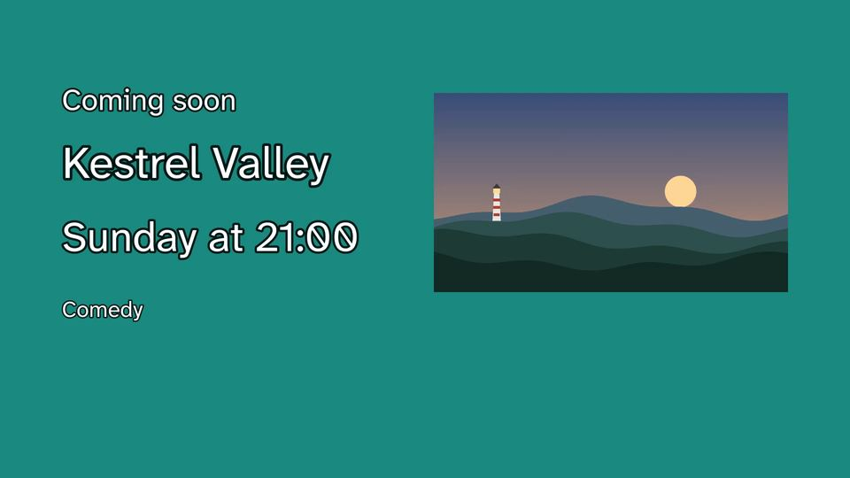

*A plain promo, for a channel with no pack promo: on the channel's colour, or on a background loop you added.*

| Setting | What it does | Choices, and the one it starts with |
|---|---|---|
| **Make promos in quiet hours** | In Starboard's quiet hours, one at a time at the lowest priority, and never while anyone is watching | Activated |
| **Promo length** | How long each promo is. Longer promos show more clips | **As the pack says (15 seconds unless it says otherwise)**, **10 seconds**, **15 seconds**, **20 seconds**, **30 seconds**, **45 seconds** or **60 seconds**. **As the pack says** |
| **Clips in each promo** | Short clips from different parts of the programme, clear of its opening titles and end credits | **By its length (about one every 5 seconds)**, or **2 clips** to **6 clips**. **By its length** |
| **Use the programme's sound in promos** | Each clip plays with its own sound, at the same loudness as the rest. A programme with no sound has the music alone | Activated |
| **Music under the programme's sound** | How loud the music is while a clip's sound plays. It is at full before the first clip and after the last | **10%**, **20%**, **30%** or **50%**. **20%** |
| **Show the station's logo on promos** | Promos made with a channel's own pack, or a plain design, show the station pack's logo, small, in a corner, clear of the clip and the words. Promos made with the station's pack carry it in their design already | Activated |
| **Promos kept for each channel** | Old ones are replaced, so they never pile up | 1 to 6. **3** |
| **Replace each promo after** | A promo is also replaced once its programme has started. When a channel's pack changes, its promos made with the old pack stop showing at once and are made again in the next quiet hour | **1 day**, **2 days**, **3 days** or **7 days**. **2 days** |
| **Show promos for your other channels** | Each channel's breaks show the promos of your other channels too | Activated |

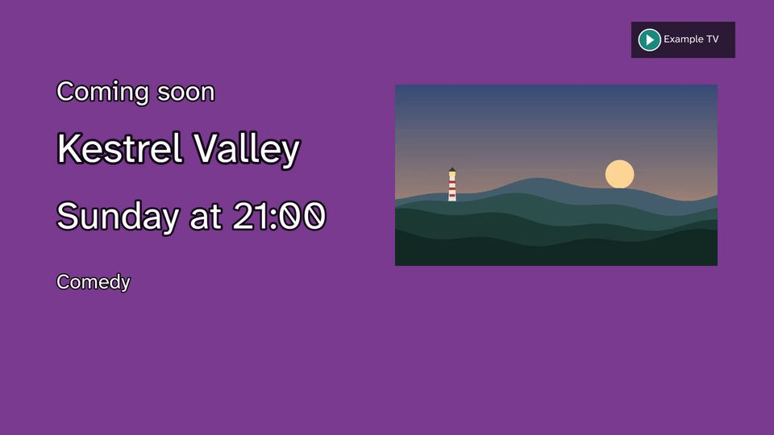

*Show the station's logo on promos, on a plain promo for a channel with no pack of its own.*

On a channel's **Holding slide and promos** card, **Promos** says how its promos are made. **Add music for its promos** takes music for this channel only, an MP3, M4A, OGG or FLAC file of 5 seconds to 10 minutes. **Add a background loop for its promos** takes a loop or picture for this channel only, as many as 20.

## Broadcast pack

Your own branding for every channel: the on-screen logo, the logo with its music, idents, bumpers, transitions, and backgrounds for the Coming up next card and the promos, with music for the promos. [Use a broadcast pack](../../use/use-a-broadcast-pack.md) says how to add one, and [Make a broadcast pack](../../use/make-a-broadcast-pack.md) how to make one.

| Row | What it does | Choices, and the one it starts with |
|---|---|---|
| **Station's pack** | Select **Upload a pack** and choose a zip of up to 60 MB made from the template. It is checked first; when it passes, every channel without a pack of its own uses it. **Stop using the pack** takes it off | None |
| **Try the example pack** | Uses Example TV, a made-up channel drawn in code, for every channel without a pack of its own. The first time, it takes about 2 minutes to make, while no channel is playing. Deactivate to go back to your own pack, or none | Deactivated |
| **The last pack checked** | What the check found: each problem with a pack that was not used, or notes on one that was, such as a picture scaled to fit | Empty until a pack is uploaded |
| **Downloads** | The template (folders, `pack.json`, its schema and a README), the placement guides for the Coming up next card, the promo and the on-screen logo, and the example pack as a zip | None |
| **Promos kept** | Each promo, with its programme, its day and time and its channel | None yet |
| **Each channel's pack** | Which pack each channel uses. Change it on the channel's page | **The station's pack** |

## Animation

**Animation** sets how each thing drawn over the picture comes on and goes off, for every channel. A channel can choose its own on its **Animation** card, where each starts at **Station default**.

| Thing | When it animates |
|---|---|
| **Coming up next and Later cards** | The words, the bar and the programme's picture come on as each card starts and go off by its end. The background stays still |
| **Straps** | The programme's name as it starts, and Up next during the end credits |
| **On-screen logo** | As a programme starts and ends, when **When it shows** is only during programmes or programmes and cards; and when it appears after the opening, with **Fades in after the opening**. When it shows always, it stays where it is |
| **Clock** | With the on-screen logo |
| **New, Repeat or Live label** | On as the programme starts, off at 2 minutes |
| **Words on the holding slide** | On as the slide starts, off by the time the next programme starts |

| Setting | What it does | Choices, and the one it starts with |
|---|---|---|
| **Coming on** | How it comes on | **The broadcast pack's, or none** (the one it starts with), **None**, **Fade in**, **Slide in from the left**, **Slide in from the right**, **Slide up from the bottom**, **Wipe on from the left** or **Grow from the centre** |
| **Going off** | How it goes off | **The broadcast pack's, or none** (the one it starts with), **None**, **Fade out**, **Slide off to the left**, **Slide off to the right**, **Slide down off the bottom**, **Wipe off to the right** or **Shrink to the centre** |
| **Speed** | How long it takes | **The broadcast pack's, or normal** (the one it starts with), **Quick, 0.3 seconds**, **Normal, 0.6 seconds** or **Slow, 1 second** |
| **Preview** | On each thing's **Coming on** row: opens a few seconds of it coming on and going off, in a new tab, drawn over a made-up picture with the choices saved | None |

Example result: the example pack's cards slide in from the left and fade out; its straps wipe on and off; its logo and clock fade, slowly; its label slides in from the right, quickly; and the words on the holding slide slide up from the bottom and fade out.

Timing stays exact: each thing comes on from its start and has gone by its end, so an animation never makes a break or a strap longer. Something shown for less time than two animations has both made shorter to fit. Each thing is drawn on its own layer only while it moves, so it costs little: measured at 720p, a programme with everything animating used no more processor than one without, and a card with animation used about half the processor of a plain one. A **Preview a frame** picture shows each thing where it rests.

## Streaming

| Setting | What it does | Choices, and the one it starts with |
|---|---|---|
| **Picture size** | The size of the stream while a channel is watched. 720p is lighter on the processor; 1080p is sharper | **720p, lighter on the processor** or **1080p, sharper**. **720p** |
| **Most channels at once** | Each channel being watched is one conversion. People watching the same channel share it | 1 to 6. **2** |
| **Stop a channel after the last viewer leaves** | Nothing runs while nobody watches | 5 to 300 seconds. **30 seconds** |
| **Copy programmes when nothing is drawn on them** | A channel with no on-screen logo, no clock, no label and no straps plays its programmes as they are, with no converting | Activated |
| **Leave out 3D films** | A 3D film plays as two pictures, side by side or one over the other. Films Jellyfin marks as 3D, or whose file name says 3D, are left out of every channel. Each film on a channel is also checked once, in quiet hours and never while anyone is watching, and one found to be 3D is left out too | Activated |

## Station

| Setting | What it does | Choices, and the one it starts with |
|---|---|---|
| **Station name** | Shown in Jellyfin's Live TV, on the cards and as the on-screen logo when that is **The station's name**. A new name is given to its tuner in Jellyfin's Live TV too | Up to 40 characters. **Home TV** |
| **First channel number** | 1 puts your channels first in Jellyfin's Live TV, before the free channels from 101 | 1 to 9000. **1** |
| **Address Jellyfin uses to reach this plug-in** | Filled in by itself: Starboard 0.23.0 and later give the plug-in its address on your home network. Enter one only if Jellyfin runs on another computer that reaches this one by another address | Filled in by itself |
| **Days in Jellyfin's guide** | Worked out when Jellyfin asks for it, about once a day | 1 to 14. **7** |

## Actions

- **Try the example pack:** makes Example TV, if it is not made yet, and uses it for every channel without a pack of its own.
- **Make promos now:** makes any promos that are due, one at a time at the lowest priority, unless someone is watching. They are also made each hour of Starboard's quiet hours.
- **Refresh Jellyfin's guide:** asks Jellyfin to read the channel list and the guide again now. The **Guide** page says when Jellyfin last read the guide and how many programmes it had.
- **Read the channels from Jellyfin again:** reads every channel's line-up now. It also runs each night at 04:40, so new episodes join.
- **Stop every channel playing:** stops every stream now. Anyone watching can choose the channel again.

## Find out more

- [Use a broadcast pack](../../use/use-a-broadcast-pack.md)
- [Make a broadcast pack](../../use/make-a-broadcast-pack.md)
- [Dashboard card](dashboard-card.md)
- [Problems](problems.md)
