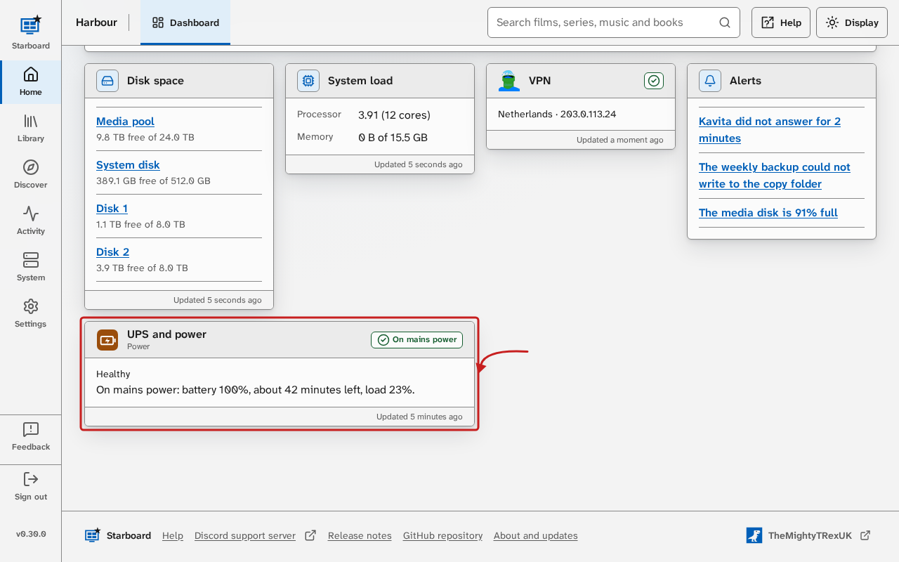
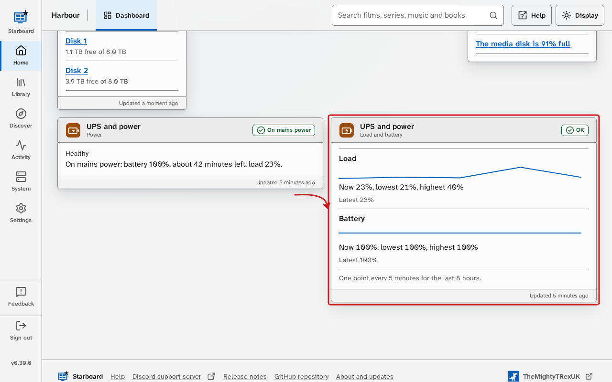
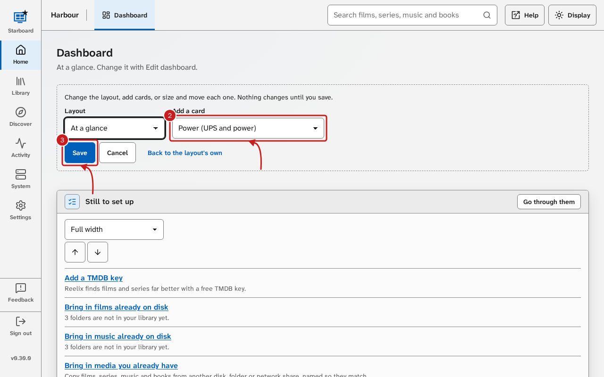

# UPS and power: Dashboard card

UPS and power adds 3 cards you can put on your dashboard. Each starts with a band: UPS and power's logo and name and a status in words. A footer says when it last changed. The cards only read what the plug-in kept at its last reading, so opening the dashboard never asks the UPS.

## Power

Shows one line: on mains power or on battery, with the battery charge, the time left and the load.

- **How often it updates:** once a minute while the dashboard is open. Nothing is asked while the browser tab is hidden.
- **Example:** On mains power: battery 100%, about 42 minutes left, load 23%.

## UPS details

Shows the UPS's name and model, its status, the battery charge, the time left, the load, the voltage in and out and the power used, whichever it reports, and the last time the power switched.

- **How often it updates:** every 5 minutes while the dashboard is open.
- **Example:**
  - Battery: 100%
  - Time left on battery: 42 minutes
  - Load: 23%

## Load and battery

Shows a small line chart for the load, the battery charge and the time left, one point every 5 minutes for the last 8 hours.

- **How often it updates:** every 5 minutes while the dashboard is open.
- **Example:** Load: Latest 23%.

## What the status says

| Status | Means |
|---|---|
| **On mains power** | The UPS is on mains power and its battery is fine. |
| **On battery** | The mains power has gone and the UPS is running on its battery. |
| **Low battery** | On battery, with the charge or the time left under the limits you chose, or the UPS says so. |
| **Replace the battery** | The UPS says its battery needs replacing. |
| **Last reading failed** | The last reading could not reach the UPS, but an earlier one worked. The card says why. |
| **Cannot read it** | The UPS has never answered. The card says why, such as that nothing is listening at that address. |
| **Needs setting up** | No address is saved yet. |
| **Scheduled** | Saved, and waiting for the first reading, which comes within a minute. |

## Add it to your dashboard

1. Select **Edit dashboard**.
2. In **Add a card**, choose the card. Its name ends with (UPS and power), such as **Power (UPS and power)**.
3. Select **Save**.

UPS and power must be added and active first. Read [Install](install.md).

## Find out more

- [Use and change the dashboard, in Starboard's help](https://themightytrex.github.io/starboard/help/topics/use-the-dashboard.html)
- [Settings](settings.md)
- [Problems](problems.md)
