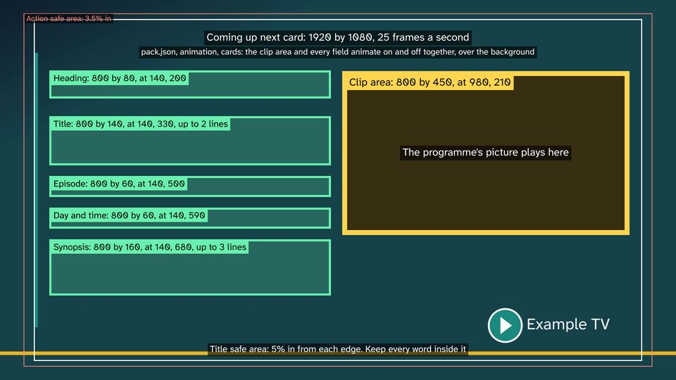
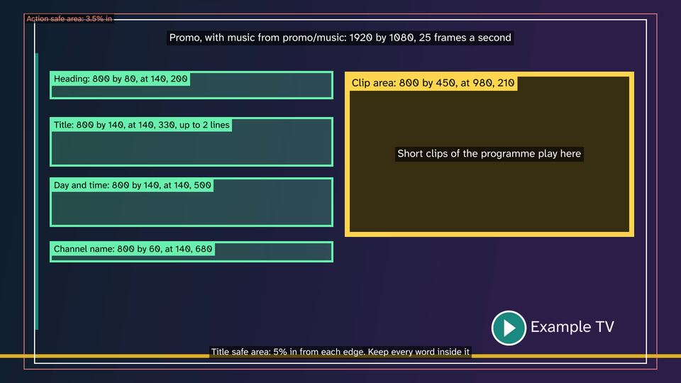
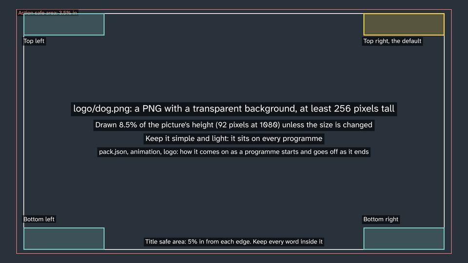
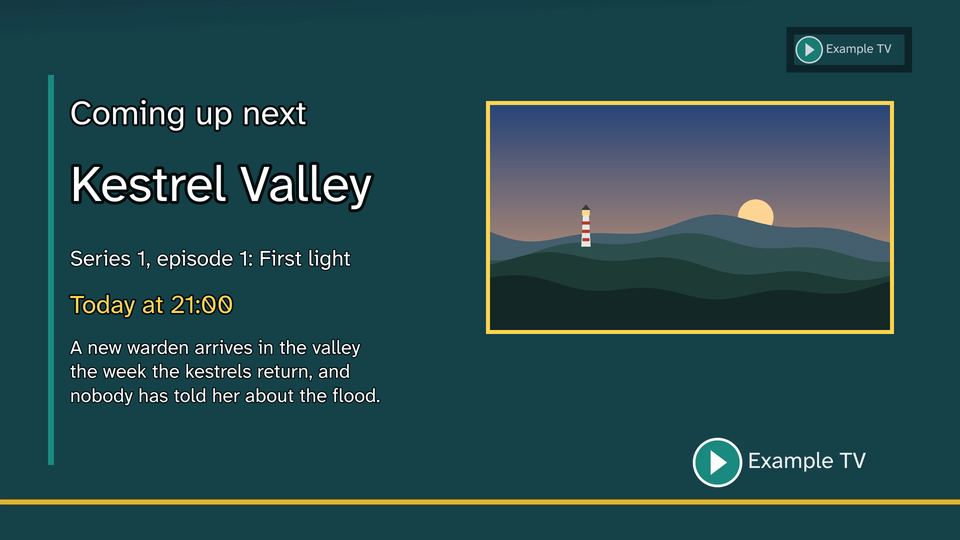
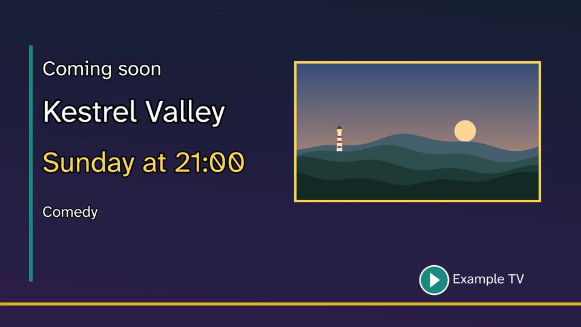

[Help centre](../README.md) · Use it · reference
<!-- help: use / tv -->

# Make branding

Branding is your own branding for the channels in [Create your own TV channel](../../tv-station/README.md). It covers the corner logo, the logo with its music, short title clips and the Coming up next card. It also covers coming-up trailers and their music, and transitions. It is one folder of files with set names and a `pack.json`. You upload it as a zip. This page is its specification.

## When would you use it

- You want your channels to have their own logo, short title clips and cards, like a broadcast channel.
- You are making the pictures and sounds, or asking someone to, and need the sizes, names and lengths.
- A pack you uploaded was not used, and you want to know why.

## Start from the template or the example

In Starboard, go to **Settings**, then **Plug-ins**, then **Create your own TV channel**, then **Branding**. Under **Downloads**:

- **The template** has every folder, a `pack.json` to fill in, `pack.schema.json` (the machine-checked rules for `pack.json`) and a README with this specification in short.
- **Placement guides** for the Coming up next card, the coming-up trailer and the corner logo are 1920 by 1080 pictures. They mark the clip area, each text field with its size and place, and the safe areas. With a pack in use, the plug-in draws the guides on the pack's own backgrounds.
- **The example pack** is Example TV, a made-up channel that the plug-in draws in code. Turn on **Try the example pack** first, and the plug-in makes it.

## Step by step

1. **Download the template.** In **Branding**, under **Downloads**, select **The template: folders, pack.json, its schema and a README**. It is a zip with one folder, `broadcast-pack`. The folder holds `pack.json`, `pack.schema.json` and `README.txt`. It also has a folder for each kind of file, each with a `what-goes-here.txt` in it, and a placement guide in `logo`, `coming-next` and `coming-up trailer`.
2. **Unzip it,** and rename the folder if you like: the name of the folder is not used.
3. **Make the corner logo,** `logo/dog.png`, the one file every pack needs: a PNG with a transparent background, 256 pixels tall or more. Keep it simple and light, as it sits on every programme. The logo placement guide marks where it sits in each corner.
4. **Make the backgrounds** for the Coming up next card and the coming-up trailer, 1920 by 1080, a still or a loop of 2 to 60 seconds. Open the placement guide in each folder in your picture or video editor, as a layer over your design. Leave the clip area and the text fields clear, because the plug-in draws into them.
5. **Add the moving pieces you want:** short title clips, very short title clips, the logo with music, transitions and music beds for the coming-up trailers, each named as [The folder](#the-folder) says. Leave out any you do not want.
6. **Fill in `pack.json`:** the pack's name, its colours, and the list of each kind of file. Take out of `pack.json` any file you did not make. The template lists `logo/logo-with-music.mp4`, `ident01.mp4`, `ident02.mp4` and `wipe01.webm`. If a file is named there but is not in the folder, the plug-in will not use the pack. Move a box only when your design needs it.
7. **Zip the folder** and upload it, as [Use branding](use-a-broadcast-pack.md) says. When the check finds a problem, the pack in use stays. **The last pack checked** lists each problem, and [What each problem means](#what-each-problem-means) says how to put it right.
8. **Check it on a channel:** on the channel's page, select **Preview a frame** and **Preview a Coming up next card**. Then watch the channel in Jellyfin's Live TV for a break.

## The placement guides

The guides are 1920 by 1080 pictures. The white line is the title safe area, 5% in from each edge, where every word goes. The pink line is the action safe area, 3.5% in, for anything that moves. With a pack in use, the guides on the **Branding** page are drawn on its own backgrounds, as these are on the example pack's.



*The Coming up next card: the programme's picture plays in the clip area, and each field is where `pack.json` places it.*



*The coming-up trailer: short clips of the programme play in the clip area.*



*The corner logo: where it sits in each corner at the medium size, 92 pixels tall at 1080, inside the safe area.*

What the plug-in draws from a pack, with the example pack:





## The folder

| File | Needed | What it is |
|---|---|---|
| `pack.json` | Yes | The pack's name, and where the clip and each text field go |
| `logo/dog.png` | Yes | The corner logo (the DOG, or bug): a PNG with a transparent background, 256 pixels tall or more (under 64 is refused) and at most 1920 by 1080 |
| `logo/logo-with-music.mp4` or `.mov` | No | The logo animated, with its music baked into the file: 1 to 20 seconds, with sound. It plays immediately before a programme when the pack has no short title clips |
| `idents/ident01.mp4`, `ident02.mp4` and on | No | As many short title clips as you like, up to 99: `short title clip` and a number of 2 or 3 digits. 2 to 60 seconds each, with sound, also `.mov`, `.mkv` or `.webm`. One plays immediately before each programme, in a random order |
| `bumpers/bumper01.mp4`, `bumper02.mp4` and on | No | Short versions of the short title clip with no music (0.4.0), up to 20: `very short title clip` and a number of 2 or 3 digits, 0.5 to 10 seconds (2 is plenty), also `.mov`, `.mkv` or `.webm`. One opens every break, and one closes each break inside a programme. Any sound in them is not played |
| `coming-next/background.mp4` | No | The Coming up next card: a video of 2 to 60 seconds that loops, or a `.png` or `.jpg` still |
| `promo/background.mp4` | No | The coming-up trailer, in the same way as the Coming up next card |
| `promo/music/music01.m4a` and on | No | Music beds for the coming-up trailers, 5 to 300 seconds each, up to 20. Also `.mp3`, `.wav`, `.flac`, `.ogg` or `.opus`. Each coming-up trailer has one, chosen at random |
| `transitions/wipe01.webm` and on | No | Wipes and stings between a programme and a break, up to 20: 0.2 to 5 seconds, with transparency, as WebM VP9 with alpha (`yuva420p`) or ProRes 4444 with alpha (`.mov`). Any name of letters, numbers, `-` and `_` |

A README, `pack.schema.json`, `placement.png` files and an `examples` folder may stay in the pack: they are not used. Any other file name is refused, so a misspelt name is found at once.

## Sizes, lengths and sound

- **Pictures** are 1920 by 1080 pixels at 25 frames a second. Another 16:9 size is scaled to fit; a picture that is not 16:9 is fitted inside with black bars, and the check says so. Under 320 by 180 or over 3840 by 2160 is refused.
- **Safe areas:** keep every word inside the title safe area. It is 5% in from each edge (96 pixels at the sides and 54 at the top and bottom). Keep anything that moves inside the action safe area, 3.5% in. Some televisions cut the edges of the picture.
- **Sound** plays at -23 LUFS (EBU R 128), with peaks under -1 dBTP. The plug-in measures each file when it checks the pack and brings it to -23 LUFS, by up to 12 dB. So a quiet short title clip is not lost after a loud programme.
- **Transitions** cut at their middle: at that moment the picture should be covered, so the change from programme to break is hidden. A transition plays its first half over the end of one and its second half over the start of the next.

## pack.json

Every position is a box, `[left, top, right, bottom]`, in pixels of 1920 by 1080, and is scaled with the picture.

```json
{
 "pack": 1,
 "name": "Your channel",
 "colours": {"text": "#FFFFFF", "accent": "#FFD54F"},
 "logo": {"dog": "logo/dog.png", "with_music": "logo/logo-with-music.mp4"},
 "short title clips": ["ident01.mp4", "ident02.mp4"],
 "coming_next": {
  "background": "coming-next/background.mp4",
  "clip": [980, 210, 1780, 660],
  "fields": {"Heading": [140, 200, 940, 280], "Title": [140, 330, 940, 470], "Episode": [140, 500, 940, 560],
             "Day and time": [140, 590, 940, 650], "Synopsis": [140, 680, 940, 840]}
 },
 "coming-up trailer": {
  "background": "promo/background.mp4",
  "clip": [980, 210, 1780, 660],
  "music": ["promo/music/music01.m4a"],
  "seconds": 15,
  "fields": {"Heading": [140, 200, 940, 280], "Title": [140, 330, 940, 470], "Day and time": [140, 500, 940, 640],
             "Channel name": [140, 680, 940, 740]}
 },
 "transitions": ["wipe01.webm"],
 "animation": {
  "cards": {"in": "left", "out": "fade", "speed": "normal"},
  "title bars": {"in": "wipe", "out": "wipe", "speed": "normal"},
  "logo": {"in": "fade", "out": "fade", "speed": "slow"}
 }
}
```

| Key | What it says |
|---|---|
| `pack` | Always 1, the version of this specification |
| `name` | The pack's name in Starboard, up to 40 characters |
| `colours` | `text` for the words, `accent` for **Day and time**, as `#RRGGBB`. White unless you change them |
| `short title clips`, `very short title clips`, `transitions`, `logo`, `music` | The files, for a check that none is missing. Every short title clip and transition in the folder is used, listed or not |
| `clip` | Where the programme's picture (Coming up next) or its clips (coming-up trailer) play. Keep it 16:9, such as 800 by 450 |
| `fields` | Where each text goes. Leave out the ones you do not want |
| `seconds` | How long each coming-up trailer is: 10 to 30, 15 unless you change it |
| `animation` | Optional, from 0.3.0: how each thing drawn over the picture comes on and goes off. Leave it out for none |

### The text fields

| Field | What is drawn |
|---|---|
| **Heading** | Coming up next, or Later on and the channel's name. On a coming-up trailer, Coming soon |
| **Title** | The programme's title, on up to 2 lines |
| **Episode** | Such as Series 2, episode 4: The crossing |
| **Day and time** | From the schedule. On a card, such as Today at 21:00; on a coming-up trailer, such as Sunday at 21:00, as a coming-up trailer is made days before it plays |
| **Synopsis** | A short synopsis, on up to 3 lines |
| **Channel name** | The channel it is on |

The words are made as large as the box allows, on as many lines as the field has, and smaller when they need more. For more control, give a field an object instead of the box. For example: `{"box": [140, 330, 940, 470], "colour": "#FFFFFF", "align": "left", "lines": 2}`. Here `align` is `left`, `centre` or `right`, and `lines` is 1 to 4.

Leave the clip area and the text fields clear in your backgrounds: the plug-in draws into them. Put the heading in a **Heading** field, not in the background, so Later cards can say Later.

### Animation

`animation` gives your pack its own movement. Each part is optional, and anything left out has no animation. A choice made in Starboard, on the **Animation** page or a channel's **Animation** card, comes before the pack's.

| Part | What animates |
|---|---|
| `cards` | The Coming up next and Later cards: the clip area and every field move together, over your background, which stays still |
| `title bars` | The programme's name as it starts, and Up next during the end credits |
| `logo` | The corner logo, as a programme starts and ends when it shows only during programmes (or with cards), and when it appears after the opening |
| `clock` | The clock beside the corner logo, with it |
| `label` | New, Repeat or Live, for the first 2 minutes of a programme |
| `holding` | The words on the waiting screen |

Each part is `{"in": "left", "out": "fade", "speed": "normal"}`:

| Key | Values |
|---|---|
| `in` | How it comes on: `none`, `fade`, `left`, `right` or `bottom` (slides in from that edge), `wipe` (wipes on from the left) or `grow` (grows from its centre) |
| `out` | How it goes off: the same values. `left`, `right` and `bottom` slide off to that edge, `wipe` wipes off to the right and `grow` shrinks to its centre |
| `speed` | `quick` (0.3 seconds), `normal` (0.6 seconds) or `slow` (1 second). `normal` unless you change it |

Timing stays exact: a thing comes on from its start and is gone by its end, so an animation never makes a break longer. A thing shown for less than two animations has both made shorter to fit. The coming-next placement guide reminds you that the clip area and the fields move together; leave room in your design for them to slide through.

## What the plug-in does with it

- **The corner logo** is `logo/dog.png`, at the size and in the corner the corner logo settings say. A channel's own logo, added on its page, is used in its place.
- **Animation**, when `pack.json` has it, is used for every thing the settings leave at **The branding's, or none**.
- **Each break** between programmes (0.5.0) runs in this order. It opens with a very short title clip. Then come coming-up trailers, trailers and clips (up to the number chosen), then one of your your own short videos. Then comes the waiting screen (or Later and Coming up next cards drawn on your background). It ends with one short title clip with its music, right before the new programme. A break inside a programme is a very short title clip, coming-up trailers and clips, a short video of your own, the waiting screen with Back soon, and a very short title clip.
- **Transitions** play at each cut between a programme and a break, chosen at random, the same one on both sides of the cut.
- **Coming-up trailers** are made in quiet hours, one at a time at the lowest priority, and never while anyone is watching. Each coming-up trailer has a few short clips of a programme coming up in the clip area. It also has a background music from `promo/music`, and its title, day, time and channel. Each channel keeps the number the settings say; old ones are replaced. They play on their own channel and, unless you turn it off, on your other channels.

## The upload, and what is checked

The station has one pack, which every channel uses, and each channel can have its own in its place, or none.

1. Zip the pack's folder. A zip with its files inside one folder is read from inside that folder.
2. In **Branding**, select **Upload a pack** and choose the zip. For one channel, open it in **Channels** and select **Upload its own pack**.
3. The plug-in checks it before anything in it is used, as [What each problem means](#what-each-problem-means) says. When it passes, it is in use at once, and anything to change is listed under **The last pack checked**. When it does not, the pack in use stays, and each problem is listed there.

The checks are these:

- The zip is at most 60 MB, the most Starboard takes. Unpacked, it is at most 400 MB and 150 files.
- Every name is one in the table.
- No file is a link or has a path outside the pack's folder.
- No file is packed far smaller than it is.
- `pack.json` passes `pack.schema.json`, and each box is inside the picture.
- FFmpeg's `ffprobe` reads every file for its type, size, length and sound.
- The logo has transparent parts.
- Each transition has transparency.

Nothing in a pack is ever run.

## What each problem means

**The last pack checked** lists each problem in the words in this table, with the file's name first. A pack with a problem is not used; a note is only for you to know, and the pack is used.

| Problem | What it means, and what to do |
|---|---|
| That file is not a zip. Choose the zip of the pack's folder | The file chosen is not a zip. Zip the pack's folder, and upload the zip |
| The zip is over 60 MB, the most Starboard takes | Make the videos shorter or smaller, or use stills for the backgrounds |
| The zip has more files than a pack may hold | A pack holds 150 files at most. Take out files the pack does not use |
| The files come to more MB unpacked than a pack may be | 400 MB at most, unpacked. Make the videos smaller |
| *file*: over 100 MB | One file is too big. Make it shorter or at a lower bit rate |
| *file*: not a name a pack uses. The template's README lists every name | The name, or its folder, is not one in [The folder](#the-folder). Check the spelling, the folder and the number of digits, such as `ident01.mp4` |
| *file*: a link, which a pack may not hold | The zip holds a shortcut or link. Put the file itself in its place |
| *file*: has a password | Zip the folder again with no password |
| *file*: a path outside the pack's folder, a path from the top of a disk, or a name with a backslash | The zip was made in a way that names files outside its folder. Zip the folder again with your computer's own Compress or Send to, Compressed folder |
| *file*: packed far smaller than it is, which a real picture or sound never is | The file does not hold a real picture or sound. Save it again from your editor |
| pack.json is missing from the top of the pack | Put `pack.json` in the pack's folder, beside `logo` and the rest |
| pack.json is not JSON | A comma, quote or bracket is missing or extra. The message says where. Check it against the example in [pack.json](#packjson) |
| pack.json is over 64 KB | `pack.json` holds only names and boxes. Take out anything else |
| pack.json, *part*, should be, needs, or is not something a pack may set | `pack.json` does not match `pack.schema.json`: the message names the part, such as `pack.json, coming-up trailer, seconds should be from 10 to 30` |
| pack.json, *part*, *field*: the box should be inside 1920 by 1080, left before right and top before bottom | A box is `[left, top, right, bottom]` in pixels of 1920 by 1080. Check the order and that it is inside the picture |
| pack.json, *part*, *field*: the box is too small to hold words or a picture | Make the box bigger |
| pack.json names *file*, which is not in the pack | A file listed in `pack.json` is not in the folder. Add it, or take it out of `pack.json`. The template lists files you may not have made |
| logo/dog.png is missing: every pack has the corner logo | Add the logo as `logo/dog.png` |
| *file*: not a PNG | The logo must be a PNG. Save it again as PNG, not a JPEG renamed |
| *file*: width by height pixels. Make it at least 64 pixels tall and at most 1920 by 1080 | The logo is too small or too big. 256 pixels tall or more is best |
| *file*: has no transparent parts. Save it with a transparent background | The logo has a solid background, which would show as a box on every programme |
| *file*: could not be read at the moment (the plug-in was busy). Upload the pack again in a minute | Nothing is wrong with the file. Upload it again |
| *file*: FFmpeg cannot read a picture in it | The video is damaged or in a form FFmpeg cannot read. Export it again as H.264 MP4 |
| *file*: has no sound | A short title clip and the logo with music need sound. The logo's music is baked into its file |
| *file*: a still picture. A short title clip is a video, or A very short title clip is a short video | Short title clips and very short title clips are videos, not stills |
| *file*: seconds. It should be from one length to another | The file is too short or too long. [The folder](#the-folder) gives each length |
| *file*: has no transparency. Save it as WebM VP9 with alpha, or ProRes 4444 with alpha | A transition without transparency would hide the picture. Export it again with its alpha channel |
| *file*: width by height pixels. Make it 1920 by 1080 | The picture is under 320 by 180 or over 3840 by 2160 |
| More files of one kind than a pack may have | Up to 99 short title clips, 20 very short title clips, 20 transitions and 20 music beds |
| *background* is in the pack, but pack.json has no part saying where the clip and the words go | Add a `coming_next` or `coming-up trailer` part to `pack.json`, as in the template |

These are notes, and the pack is still used:

| Note | What it means |
|---|---|
| *file*: not 16:9, so it is fitted inside the picture with black bars | Make it 16:9, such as 1920 by 1080, to fill the picture |
| *file*: so it is scaled to the picture | A 16:9 size other than 1920 by 1080 is scaled to fit |
| *file*: frames a second, so it is played at 25 | It is played at 25 frames a second |
| *file*: LUFS, so it is played louder or quieter | Its sound is brought to -23 LUFS, by up to 12 dB |
| promo/music has no music, so coming-up trailers have none | Add music beds in `promo/music`, or add music for coming-up trailers in **Short title clips, clips and music** |
| pack.json, *part*: no Title field, so the programme's title is not drawn | Add a **Title** field if you want the title |
| pack.json, *part*: outside the title safe area, so some televisions cut it | Move the clip area or the field inside the white line of the placement guide |

## Things to note

- Making the example pack takes about 2 minutes, at the lowest priority, and up to about 500 MB of memory for that time. It is made once and kept, and only while no channel is playing; a channel chosen meanwhile is asked to wait.
- A pack's files stay in the plug-in's folder, in `packs`. Removing the station's pack keeps one copy until the next is removed.
- A coming-up trailer is made at the picture size of the stream, 720p unless you change it.

## Find out more

- [Use branding](use-a-broadcast-pack.md)

- [Create your own TV channel: Settings](../plugins/tv-station/settings.md)
- [Create your own TV channel: Problems](../plugins/tv-station/problems.md)
- [pack.schema.json](../../tv-station/pack.schema.json)
