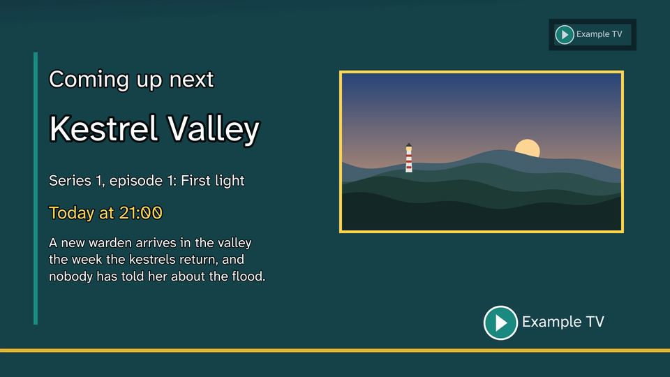
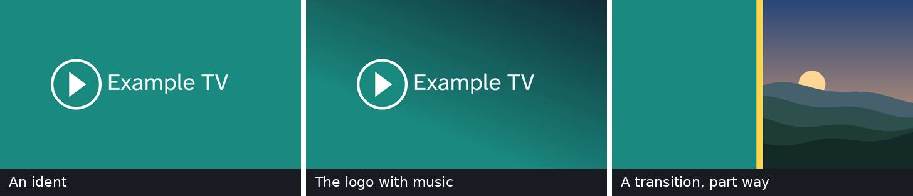

[Help centre](../README.md) · Use it · how-to
<!-- help: use / tv -->

# Use branding

Branding gives the channels in [Create your own TV channel](../../tv-station/README.md) your own branding. That covers the logo in the corner of the picture, the logo with its music, short title clips, very short title clips and transitions. It also covers the Coming up next card and coming-up trailers with their music. This page says how to add one to the station or to one channel, replace it, remove it, and try the example pack. To make one, use [Make branding](make-a-broadcast-pack.md).

## When would you use it

- You want every channel to share one broadcaster's branding, with one logo and set of short title clips.
- You want one channel, such as a children's channel, to have branding of its own.
- You want to find out what a pack does before you make one.

## Before you start

- You have added Create your own TV channel in Starboard, with at least one channel. Its pages are in **Settings**, then **Plug-ins**, then **Create your own TV channel**.
- A pack is one zip of up to 60 MB, made from the template. Nothing in a pack is ever run. FFmpeg only reads its pictures and sounds.

## Try the example pack

The example pack, Example TV, is a made-up channel that the plug-in draws in code. It has a logo, the logo with music, 3 short title clips, a Coming up next card, a coming-up trailer with 2 music beds and 3 transitions. It holds nothing of anyone else's.

1. Go to **Branding**.
2. Under **The station's pack**, turn on **Try the example pack**.
3. The first time, the plug-in makes it at the lowest priority. This takes about 2 minutes while no channel is playing. The row says **Being made**, then **In use**.
4. Every channel without a pack of its own now uses it. Open a channel and select **Preview a frame** or **Preview a Coming up next card**, or watch a channel in Jellyfin's Live TV.

To stop trying it, turn off **Try the example pack**. The channels go back to the station's own pack, or to none.

To start your own pack from it, go to **Downloads** and select **The example pack, as a zip**. Unzip it, change its files, and upload it as your own.

## Add a pack for every channel

1. Go to **Branding**.
2. Under **The station's pack**, select **Upload a pack**, and choose the zip.
3. The pack is checked before anything in it is used. When it passes, **Station's pack** shows its name and its logo, and every channel without a pack of its own uses it at once. Anything to change is listed under **The last pack checked**.
4. When it does not pass, the pack in use stays, and each problem is listed under **The last pack checked**. [What each problem means](make-a-broadcast-pack.md#what-each-problem-means) says how to put each right.

Coming-up trailers made with the old pack stop showing at once. The plug-in makes them again with the new pack in the next quiet hour, or when you select **Make coming-up trailers now**.

## Give one channel its own pack

1. Go to **Channels** and open the channel.
2. On the **Corner logo and branding** card, select **Upload its own pack**, and choose the zip. The plug-in checks it the same way.
3. In **Branding** on the same card, choose **Its own pack**.

A channel's **Branding** has two other choices. **The station's pack** is the one it starts with. **No pack** is for a channel with no branding. It shows its own logo or name in the corner, plain Coming up next cards, and plain coming-up trailers when there is music for coming-up trailers. **Each channel's pack**, on the **Branding** page, lists which pack each channel uses.

A channel's own logo, added with **Add logo** on the same card, takes the place of the pack's logo. The channel keeps the rest of the pack.

## Replace a pack

Upload the new zip in the same place: **Upload a pack** for the station, or **Upload its own pack** for a channel. The plug-in checks the new pack first. It takes the old one's place only when it passes, so a pack with a problem never leaves the channels with nothing.

To change one file, such as a new short title clip, change it in your copy of the pack's folder, zip the folder again and upload it.

## Remove a pack

- **The station's pack:** in **Branding**, select **Stop using the pack**. Channels left at **The station's pack** then have no pack. One copy is kept in the plug-in's folder until the next is removed.
- **A channel's own pack:** on the channel's **Corner logo and branding** card, select **Remove its pack**. The channel uses the station's pack.
- **For one channel only, without removing it:** choose **No pack** in **Branding** on the channel's card.

## What changes on the channels

| From the pack | Where it shows |
|---|---|
| `logo/dog.png` | In the corner of the picture, at the size and in the corner the settings say |
| Short title clips | One immediately before each programme, in a random order |
| Very short title clips | One opens every break, and one closes each break inside a programme |
| The logo with music | Before a programme, when the pack has no short title clips |
| Transitions | At each cut between a programme and a break |
| The Coming up next background | The Coming up next and Later cards, with the programme's picture and words drawn in |
| The coming-up trailer background and music | The coming-up trailers made in quiet hours |
| `animation` in `pack.json` | How the cards, title bars, logo, clock, label and waiting screen words come on and go off, unless the **Animation** settings choose |

## Things to note

- Making the example pack takes up to about 500 MB of memory for about 2 minutes, at the lowest priority. It is made once and kept.
- A pack's files stay in the plug-in's folder, in `packs`. Removing the plug-in keeps them with its other files.
- Starboard takes uploads of up to 60 MB, so keep the zip under that: use stills for backgrounds, or shorter loops.

## Find out more

- [Make branding](make-a-broadcast-pack.md)
- [Create your own TV channel: Settings](../plugins/tv-station/settings.md#broadcast-pack)
- [Create your own TV channel: Problems](../plugins/tv-station/problems.md)
